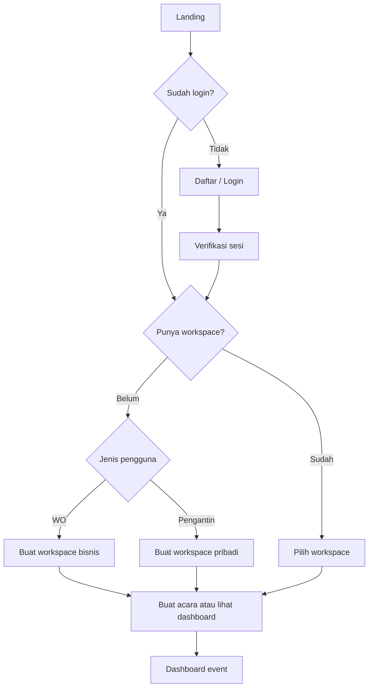
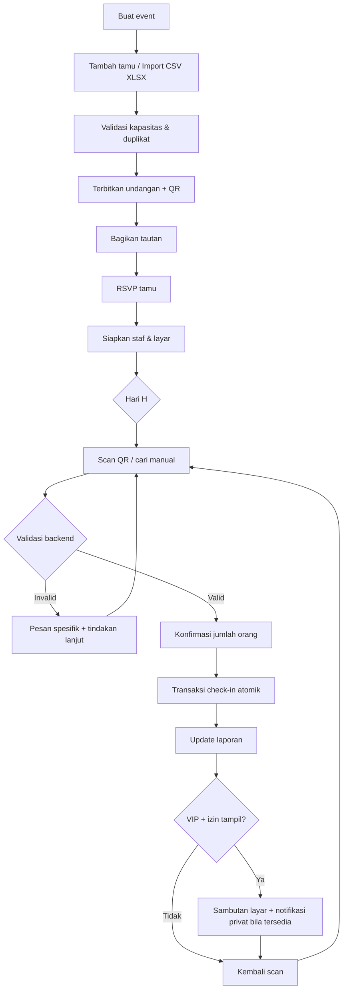
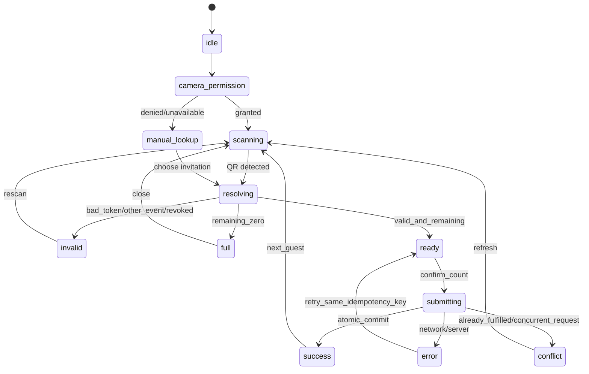

# COPY-PASTE ALL IN ONE — WEDDINGHUB

Gunakan dokumen gabungan ini jika ingin mengirim satu teks panjang ke coding agent. Dokumen ini berisi prompt eksekusi, PRD, wireframe, backlog, dan aturan agent secara utuh. Cara yang lebih disarankan: taruh semua file di workspace dan hanya paste `04_PROMPT_ANTIGRAVITY.md`.


---

# LAMPIRAN FILE: 04_PROMPT_ANTIGRAVITY.md

# PROMPT UNTUK GOOGLE ANTIGRAVITY / AI CODING DI VS CODE

> Cara pakai: buka folder proyek baru di VS Code, masukkan semua file paket WeddingHub ke folder itu, kemudian copy **teks di bawah garis** ke chat Agent Google Antigravity. Jika AI-mu bernama lain, instruksi tetap dapat dipakai. **Jangan paste ke terminal**; paste ke chat AI coding agent.

---

Kamu adalah **Senior Full-Stack Engineer, Software Architect, UI/UX Engineer, QA Engineer, dan Security Reviewer** yang membangun produk SaaS nyata, bukan prototipe tampilan. Buat aplikasi bernama kerja **WeddingHub**, yaitu sistem pengelolaan undangan dan tamu pernikahan untuk **Wedding Organizer dan calon pengantin sekaligus**, multi-workspace, multi-event, multi-role.

**KONTEKS & DOKUMEN WAJIB:**
1. Baca `01_PRD_WEDDINGHUB.md` sampai tuntas sebagai spesifikasi produk dan business rules.
2. Baca `02_UX_FLOW_WIREFRAMES.md` untuk route, user flow, layout dan state setiap screen.
3. Baca `03_BACKLOG_TEST_CASES.md` untuk rencana sprint dan acceptance tests.
4. Patuhi `AGENTS.md` untuk arsitektur, keamanan, prosedur implementasi.
5. Bila file berada dalam root atau subfolder `docs/`, temukan sesuai nama. Jika file benar-benar tidak ada, gunakan ringkasan REQUIREMENTS di bawah dan laporkan dokumen apa yang hilang; jangan berpura-pura sudah membacanya.

**RINGKASAN PRODUK:**
- Pengguna publik dapat mendaftar sebagai WO (mengelola banyak event) atau pengantin (mengelola event sendiri). Satu akun dapat mempunyai beberapa workspace dan role berbeda.
- Role: platform_admin, workspace_owner, workspace_admin, event_manager, couple, supervisor, receptionist, usher, viewer, guest_public.
- Tamu dikelola sebagai invitation group (individual/couple/family) dengan kapasitas orang, kategori regular/VIP/VVIP, nomor meja opsional, dan privasi publik.
- Admin menambah/import tamu, generate undangan individual + QR unik, share manual, guest RSVP, operator scan QR atau cari manual, konfirmasi jumlah peserta yang datang, sistem merekam kedatangan.
- Check-in bisa parsial, tidak boleh melebihi kapasitas, konsisten pada request bersamaan, dan idempotent. Supervisor bisa koreksi dengan alasan dan audit.
- Dashboard jumlah undangan, orang diundang, RSVP, tamu hadir, grup hadir, VIP. Laporan dan export sesuai plan.
- Layar TV/LED bisa pairing aman ke event, menampilkan welcome real-time; privasi default nonpublik. Notifikasi usher privat lanjutan.
- Paket Free / Pro / Pro Plus dikenakan per event, kuota contoh 50/500/2000 invitation groups dan 1/3/10 scanner aktif. Enforcement backend. Upgrade manual oleh admin sampai gateway tersedia.
- Semua data event/workspace harus terisolasi. Jangan pernah kirim secret server ke browser.

**STACK YANG DIINGINKAN:**
- Next.js App Router dengan TypeScript strict, Tailwind CSS, shadcn/ui; UI Bahasa Indonesia responsive.
- Supabase Auth + PostgreSQL + RLS + Storage; Supabase Realtime terproteksi untuk display (polling fallback). Supabase migrations versi kontrol.
- Zod, React Hook Form, library QR/scanner yang aman dan compatible mobile HTTPS.
- Vitest untuk unit, Playwright untuk E2E, integration/Postgres test khusus concurrency + RLS.
- Boleh menyesuaikan versi library berdasarkan package yang kompatibel dan jelaskan alasan; hindari setup/tooling yang deprecated.

**GAYA UI:**
Premium minimal wedding SaaS, bukan landing page generik. Warna navy #15263F, ivory #FAF8F4, gold #B28A50, success #16805D, danger #C33F49; aksen gold secukupnya. Sidebar desktop, mobile-friendly cards, scanner one-hand dengan CTA besar, state loading/error/empty lengkap, keyboard focus dan aksesibilitas. Teks semua berbahasa Indonesia. Gunakan layout di dokumen wireframe sebagai acuan, buat hasil visual rapi.

**PRINSIP IMPLEMENTASI PENTING:**
1. Mulai dengan inspeksi folder proyek, lalu tulis rencana pendek file tree, skema data, dan urutan implementasi. Setelah itu **langsung implementasikan Sprint 0 dan Sprint 1**, jangan berhenti pada jawaban teori atau desain gambar.
2. Tulis file kode sungguhan ke workspace, lakukan install dependency yang diperlukan sesuai izin dan jalankan test/build. Jangan hanya menampilkan code snippet dalam chat. Folder proyek sudah berisi file dokumentasi; jika alat scaffold menolak folder yang tidak kosong, scaffold di subfolder sementara lalu pindahkan/merge hasilnya secara aman ke root **tanpa menghapus file `.md` dan `AGENTS.md`**.
3. Kerjakan bertahap dan tunjukkan apa yang berfungsi. Jangan membuat seluruh fitur sekaligus tanpa test. Setelah Sprint 0–1 lolos, siapkan daftar next tasks Sprint 2–5 berdasarkan dokumen.
4. Gunakan Supabase real schema dan migrations. Jika belum ada kredensial Supabase, buat `.env.example`, setup README, migration dan adapters yang jelas; gunakan local development yang memungkinkan. **Jangan hardcode kredensial, jangan memalsukan koneksi database, dan jangan mengklaim implementasi real selesai jika belum terhubung.**
5. Seed data hanya untuk development/test dengan nama contoh yang ditandai. Jangan menampilkan dummy rows di production. Di tempat yang belum siap, tampilkan empty state atau disabled dengan label `Segera hadir`.
6. Security harus ketat: validasi backend dan RLS, revoke default grants bila perlu, audit critical mutations, roles, hashed unpredictable tokens untuk QR/public/member invite, permissions layar TV, rate limiting, file validation, error sanitization. No secrets in client. Jangan ambil jalur pintas yang membuat data WO A bisa terlihat WO B.
7. Data model wajib memisahkan `workspace`, `event`, `membership`, `invitation_group`, `invitation`, `rsvp`, `checkin_entries`, `plan`, `event_license`, `display_session`, `audit_log`.
8. Buat check-in transaksi atomik dengan row lock atau mekanisme SQL yang setara. `idempotency_key` unik. Jangan pakai pola read-count lalu update di dua HTTP calls yang race-prone.
9. RSVP bukan check-in. Kuota keluarga adalah jumlah orang, bukan jumlah QR. Beri label metrik yang jelas.
10. Online-first untuk hari-H; jika offline tampilkan peringatan jujur dan SOP, bukan false-success; dukungan offline multi-device adalah fitur lanjutan.
11. Jangan membuat payment gateway/WhatsApp blast palsu. Untuk awal share undangan manual; upgrade memerlukan approval platform admin dan audit.
12. Tanyakan input hanya jika benar-benar blocking seperti API key/deployment authorization; jika tidak blocking, gunakan default PRD dan teruskan implementasi. Hindari modifikasi destruktif data/file existing tanpa meminta izin.

**OUTPUT PERTAMA YANG HARUS KAMU BUAT:**
A. Ringkasan maksimal 20 baris mengenai pemahaman produk, asumsi teknis, dan file tree.
B. Buat kode Sprint 0: Next.js app, theme, landing minimal, auth, workspace schema, RLS/migrations, setup env, layout, lint/test config.
C. Lanjut Sprint 1: onboarding WO/pengantin, workspace switcher, create/edit event, dashboard WO dan event, member invite system, route authorization.
D. Tambahkan test dasar untuk auth/roles/isolation dan jalankan lint/typecheck/build; beri hasil aktual.
E. Berikan tiga langkah manual berikutnya dan instruksi menjalankan aplikasi (mis. `npm install`, membuat project Supabase, menyalin env, apply migration, `npm run dev`).
F. Usulkan pekerjaan Sprint 2 berikutnya: guest CRUD/import, invitation groups/QR; **jangan mengklaim Sprint 2 telah selesai jika belum dikerjakan**.

**DEFINITION OF DONE:** code terstruktur, UI responsif, database/migration nyata, hak akses backend, empty/loading/error states, lint/typecheck/build tidak error, pengujian sesuai risiko, README lengkap. Jika tes tak dapat dijalankan karena kendala lingkungan, tulis penyebab nyata dan langkah reproduksinya.

Mulai sekarang. Pertama baca seluruh dokumen lokal yang disebutkan dan lanjutkan implementasi Sprint 0–1 dalam workspace ini.


---

# LAMPIRAN FILE: 01_PRD_WEDDINGHUB.md

# PRD WEDDINGHUB — Sistem Undangan & Penerimaan Tamu Pernikahan

**Versi dokumen:** 1.0 | **Tanggal:** 27 Oktober 2026 | **Bahasa produk:** Indonesia | **Status:** Spesifikasi awal siap implementasi bertahap

> Nama **WeddingHub** adalah nama kerja/placeholder, bukan merek final. Spesifikasi ini menetapkan asumsi MVP secara eksplisit; jika detail belum ditentukan, terapkan default tertulis di sini. Jangan menciptakan fitur pembayaran/WhatsApp yang seolah telah terhubung ke layanan nyata.

## 1. Visi, masalah, tujuan

**Visi:** Satu platform SaaS multi-tenant untuk Wedding Organizer (WO) dan calon pengantin agar dapat mengelola acara, undangan digital, RSVP, daftar tamu, check-in QR, layar sambutan dan laporan tanpa memindahkan data antarsistem.

**Masalah utama:** pengelolaan nama tamu di spreadsheet; check-in manual lambat; duplikasi pencatatan; kapasitas undangan keluarga berbeda dari jumlah individu yang hadir; sulit koordinasi VIP/usher; WO mengelola banyak klien; pengantin membutuhkan transparansi pelaporan.

**Target pengguna:** (a) WO yang menangani banyak event; (b) pasangan yang membuat event tanpa WO; (c) staf penerima tamu, supervisor, usher; (d) tamu tanpa akun.

**Tujuan MVP yang terukur (target validasi, bukan janji produksi):**
1. Membuat satu acara sampai siap menerima tamu tanpa bantuan developer.
2. Check-in QR normal selesai maksimal beberapa detik pada internet stabil; gunakan pengujian perangkat sungguhan.
3. Kapasitas undangan dan kedatangan parsial tercatat benar walau terjadi scan serentak.
4. Pemisahan data antar-workspace/event teruji dengan tes negatif.
5. Laporan rekonsiliasi sesuai riwayat transaksi check-in.
6. Bisa diuji dengan sekurangnya dua WO dan dua pasangan, termasuk pilot acara nyata.

**Bukan target MVP:** aplikasi native Android/iOS, editor undangan drag-and-drop penuh, auto blast WhatsApp, payment gateway otomatis, seating map visual, sinkronisasi offline multi-perangkat, inventaris souvenir canggih, marketplace vendor, AI seating planner.

## 2. Prinsip dan keputusan awal

- **Satu aplikasi web responsif/PWA online-first**, tiga pengalaman UI: desktop WO, mobile pengantin, mobile scanner; route display fullscreen untuk TV.
- **Satu identitas bisa memiliki banyak role dan workspace**. Semua operasi menentukan `active_workspace` dan `event_id`, diverifikasi di backend, bukan percaya frontend.
- **Semua event memiliki owner workspace** (tipe `wo` atau `couple`), dan tamu/petugas diatur per event. Pasangan dapat menjadi collaborator pada event milik WO tanpa otomatis mengambil alih kepemilikan.
- **Paket per event** (`free`, `pro`, `pro_plus`), bukan per user; batas ditegakkan pada backend. Harga bukan hard-coded business logic.
- **Setiap undangan mewakili satu pihak penerima**: satu individu, pasangan, atau keluarga, dengan `max_attendees >= 1`; check-in boleh parsial.
- **RSVP tidak sama dengan check-in**: RSVP adalah rencana, check-in adalah kehadiran terkonfirmasi.
- **QR check-in bukan bukti identitas**; petugas dapat memverifikasi manual sesuai SOP.
- **MVP memerlukan internet saat check-in live**; sediakan ekspor daftar cadangan dan SOP manual. Jangan mengklaim fitur offline otomatis sudah aktif.
- **Privasi VIP:** default layar publik tidak menampilkan nama VIP tanpa pilihan eksplisit dari penyelenggara dan persetujuan/landasan yang sesuai; internal usher dapat menerima notifikasi sesuai izin.
- **Penagihan:** tahap awal aktivasi paket oleh super admin setelah verifikasi manual, dengan status jelas. Belum ada integrasi payment gateway palsu.

## 3. Terminologi domain

| Istilah | Definisi |
|---|---|
| Account/User | Identitas login (Supabase Auth) |
| Workspace | Area organisasi WO atau pasangan pribadi; owner pengelola penagihan |
| Event | Satu acara/resepsi dengan waktu dan lokasi spesifik |
| Event membership | Akses seseorang dalam event beserta role-nya |
| Invitation Group | Satu unit undangan (individu/keluarga), mempunyai kuota orang |
| Guest | Data individu opsional yang terkait undangan |
| Public invite token | Token acak untuk membuka undangan publik dan RSVP |
| QR check-in token | Token acak berbeda untuk proses check-in |
| RSVP | Konfirmasi rencana jumlah kehadiran |
| Check-in ledger | Catatan penambahan/pengurangan peserta, tidak boleh hilang tanpa audit |
| Display session | Sesi layar publik yang dipasangkan ke event dengan izin terbatas |
| License/Entitlement | Hak dan batas fitur event berdasarkan paket |

## 4. Persona dan hak akses

### 4.1 Role

1. `platform_admin` (global): kelola paket, aktivitas sistem, aktivasi manual, support terbatas. Data pribadi tamu tidak bebas ditampilkan di dashboard admin.
2. `workspace_owner`: kelola workspace, pemilik akses/billing, membuat event, kelola anggota.
3. `workspace_admin`: membantu kelola workspace dan event, tidak dapat transfer kepemilikan/billing tanpa izin khusus.
4. `event_manager`: mengelola satu event, undangan/tamu, operator, layar, laporan.
5. `couple`: mengelola informasi acara, tamu, undangan, RSVP, melihat laporan; tidak boleh mengubah billing atau hak akses owner tanpa izin.
6. `supervisor`: memantau dan mengoreksi check-in dengan alasan, mengelola petugas shift.
7. `receptionist`: scan QR, mencari undangan, check-in manual, membaca daftar minimum yang dibutuhkan.
8. `usher`: menerima daftar kedatangan VIP dan nomor meja yang ditugaskan; tidak bisa ekspor seluruh daftar tamu.
9. `viewer`: melihat ringkasan/laporan tanpa mengubah data.
10. `guest_public`: tanpa login, hanya dapat melihat undangan yang tokennya dimiliki dan mengisi RSVP terbatas.

### 4.2 Matriks izin inti (server-side)

| Tindakan | Owner/Admin WO | Manager | Couple | Supervisor | Receptionist | Usher | Viewer |
|---|---|---|---|---|---|---|---|
| Buat event di workspace | Ya | Tidak | Hanya bila owner workspace pribadi | Tidak | Tidak | Tidak | Tidak |
| Edit detail event | Ya | Ya | Ya (kecuali kepemilikan/tagihan) | Tidak | Tidak | Tidak | Tidak |
| Kelola undangan & data tamu | Ya | Ya | Ya | Lihat sesuai tugas | Pencarian terbatas | VIP relevan saja | Tidak |
| Import/export Excel | Ya | Ya | Ya | Export terbatas jika diizinkan | Tidak | Tidak | Tidak |
| Kelola peran / undang staf | Ya | Ya (bukan owner) | Izin event terbatas | Tidak | Tidak | Tidak | Tidak |
| Scan & check-in | Ya | Ya | Opsional berdasarkan grant | Ya | Ya | Tidak | Tidak |
| Koreksi kehadiran | Ya | Ya | Tidak secara default | Ya + alasan | Tidak | Tidak | Tidak |
| Konfigurasi layar/VIP | Ya | Ya | Ya | Bisa pilih mode | Tidak | Tidak | Tidak |
| Lihat daftar penjemputan VIP | Ya | Ya | Ya | Ya | Perubahan terbatas | Ya | Tidak |
| Kelola paket event | Pemilik pembayar | Tidak | Owner workspace pribadi | Tidak | Tidak | Tidak | Tidak |
| Laporan ringkasan | Ya | Ya | Ya | Ya | Ringkas shift | VIP shift | Ya |

Kunci: role tidak selalu sama dengan pembayaran. `workspace_memberships` dan `event_memberships` adalah sumber kebenaran. Semua query wajib difilter dan diotorisasi pada server/RLS. Satu orang dapat menjadi owner WO sekaligus pasangan di event lain.

## 5. Paket dan batas fitur (konfigurabel, hipotesis awal)

| Entitlement | Free | Pro | Pro Plus |
|---|---:|---:|---:|
| Undangan unik per event | 50 | 500 | 2.000 |
| Operator scanner aktif | 1 | 3 | 10 |
| Check-in QR dan manual | Ya | Ya | Ya |
| RSVP sederhana | Ya | Ya | Ya |
| Undangan templat | 1 basic | Beberapa premium | Premium + branding |
| Import XLSX/CSV | Tidak / input manual saja | Ya | Ya |
| Layar sambutan standar | Tidak | Ya | Ya |
| Notifikasi internal VIP otomatis | Tidak | Tidak | Ya |
| Penempatan meja & souvenir | Tidak | Dasar (belakangan) | Lanjutan (belakangan) |
| Export laporan Excel | Ringkasan CSV | Detail | Detail |
| White label | Tidak | Tidak | Tahap lanjutan |

- Kuota dihitung **per event**; Free tidak boleh menghapus data lama saat upgrade.
- Limit jumlah operator = sesi scanner valid yang aktif; admin memiliki tindakan memutus sesi perangkat lain.
- Harga yang mungkin diuji: Pro Rp199.000/event dan Pro Plus Rp499.000/event. Ini **hipotesis**; simpan harga dalam konfigurasi, bukan angka tertanam di komponen.
- Belum ada pembayaran online dalam MVP. `pending_manual_payment` -> verifikasi admin -> `active`; `expired` jika masa berlaku habis. Trial/free langsung aktif.
- Bila kuota tercapai, tampilkan pesan terarah dan upgrade CTA; jangan membiarkan backend menambah data melewati batas.
- Jangan membuat fitur Pro Plus terlihat bekerja padahal hanya animasi. Beri label `Segera hadir` jika belum dikerjakan.

## 6. Alur end-to-end

### FLOW-01 Registrasi sendiri (pengantin)

`Landing -> Register / Login -> Verifikasi email -> Pilih "Pengantin" -> Buat workspace personal -> Buat event -> Paket Free -> Dashboard event -> Input tamu -> Undangan -> RSVP -> Hari H: scan -> Laporan`

**Aturan:** registrasi harus idempotent; refresh halaman tidak membuat workspace/event duplikat. Wizard bisa disimpan sebagai draft. Tanggal event menggunakan timezone pilihan (default Asia/Jakarta).

### FLOW-02 WO mengelola pasangan

`Register -> Pilih "Wedding Organizer" -> Buat workspace WO -> Dashboard WO -> Tambah event klien -> Undang pasangan melalui link aman -> Couple terima undangan & login -> Couple hanya melihat event yang dibagikan -> WO mengundang petugas -> Pengelolaan bersama -> Hari H -> Laporan`

**Aturan:** undangan member memiliki expiry dan status `pending / accepted / expired / revoked`; penerima baru diberi akses setelah autentikasi dan verifikasi token. Owner workspace dapat mencabut akses; audit setiap perubahan.

### FLOW-03 Import data tamu

`Event -> Tamu -> Import -> Download template -> Upload CSV/XLSX -> Preview dan mapping kolom -> Validasi -> Konfirmasi -> Hasil import -> Generate link/QR`.

Template kolom: `nama_penerima, nomor_hp_opsional, tipe_undangan, kapasitas, kategori, nama_meja_opsional, catatan_internal_opsional`.

Validasi: nama wajib, kapasitas 1..20 (konfigurabel), file maksimal 5 MB sebagai default, hanya XLSX/CSV, trim whitespace, normalisasi nomor telepon tanpa memaksa. Deteksi kandidat duplikat **per event**, tampilkan preview, jangan gabungkan otomatis tanpa konfirmasi. Import transaksi terkelola; baris salah dilaporkan dan bisa dikoreksi. Gunakan batas paket. Data tamu tidak boleh terekspos ke uploader lain.

### FLOW-04 Membuat undangan dan RSVP

`Event -> Undangan -> Pilih template -> Isi nama pasangan/tanggal/lokasi/cerita singkat opsional -> Preview mobile -> Publikasikan -> Generate URL unik per invitation group -> Bagikan manual via tautan/WhatsApp share -> Tamu buka halaman -> Pilih hadir/tidak/belum pasti + jumlah hadir <= kuota -> Simpan RSVP -> Dashboard update`.

Keamanan: token publik dan token QR check-in terpisah dan random berentropi tinggi; simpan hash token jika memungkinkan; token bisa di-rotate oleh manager. Jangan tampilkan seluruh daftar tamu. Tamu tidak perlu membuat akun. Rate limit form publik. Tidak ada WhatsApp blast otomatis.

### FLOW-05 Check-in dan partial arrival

`Petugas login -> Pilih event -> Mulai sesi scanner -> Izin kamera -> Scan QR -> Server validasi event+token+izin+status+kuota -> Preview (nama, kategori, sisa kuota) -> Pilih jumlah datang -> Konfirmasi -> Server transaksi atomik -> Sukses -> Update statistik -> Trigger layar/notifikasi jika diizinkan`.

**Kasus:** undangan 4 orang, 2 hadir pagi, 2 hadir kemudian. Kedua transaksi valid; check-in kelima ditolak. QR berbeda event ditolak. QR dinonaktifkan ditolak. Scan ganda bersamaan tidak boleh melewati kuota. Repeated request akibat refresh memakai idempotency key sehingga tidak menggandakan transaksi.

`Cari Manual`: petugas mencari nama dalam event, hasil terbatas, pilih invitation group, konfirmasi jumlah datang; log `method=manual`.

### FLOW-06 VIP/VVIP datang

`Check-in selesai -> Tamu bertanda VIP -> Server membuat event_notifikasi -> Jika layar publik aktif dan public_display_allowed=true -> display menampilkan sambutan sementara -> Jika Pro Plus dan usher ditugaskan -> notifikasi privat sampai diakui (ack) -> kembali ke layar default.`

Mode display: `default`, `welcome`, `privacy_mode`, `paused`; durasi default 8 detik, dapat diatur 5–15 detik. Jika ada banyak VIP dalam waktu pendek gunakan antrean FIFO dengan tombol skip oleh supervisor. Jangan broadcast nama, nomor HP, atau catatan privat di channel tanpa autentikasi.

### FLOW-07 Setelah acara

`Event -> Laporan -> Ringkasan undangan vs orang -> RSVP vs hadir -> Kategori VIP -> Riwayat check-in -> Export CSV/XLSX sesuai paket -> Tandai acara selesai -> Arsip`.

Perbedaan ukuran harus jelas: `jumlah undangan`, `kuota orang diundang`, `jumlah orang RSVP`, `jumlah orang hadir`, `jumlah invitation group yang hadir`. Jangan mengganti semua menjadi label ambigu "jumlah tamu".

### FLOW-08 Revisi data saat hari H

Supervisor membuka check-in detail -> pilih Koreksi -> memasukkan alasan wajib -> memasukkan jumlah koreksi (tidak boleh negatif total) -> konfirmasi -> catat correction entry serta user/timestamp -> dashboard konsisten. Receptionist tidak bisa menyunting log lama atau menghapus ledger.

## 7. Kebutuhan fungsional dan acceptance criteria

**Priority:** P0 wajib sebelum pilot; P1 sesudah core; P2 lanjutan.

| ID | Prioritas | Requirement | Kriteria penerimaan minimal |
|---|---|---|---|
| AUTH-01 | P0 | Daftar/masuk/logout/verifikasi/reset password | User hanya masuk setelah sesi valid; route aman di server |
| ORG-01 | P0 | Workspace WO/personal | Owner terbentuk sekali, dapat memilih workspace aktif |
| ORG-02 | P0 | Undang/cabut anggota | Token ekspire; role tak bisa melebihi hak pengundang |
| EVT-01 | P0 | CRUD event & status | Event milik workspace; hanya role berhak bisa ubah |
| EVT-02 | P0 | Event membership | User bisa di lebih dari satu event dan hanya melihat yang sah |
| GST-01 | P0 | Tambah/ubah/cari tamu | Validasi nama, kapasitas, kategori; pencarian hanya event aktif |
| GST-02 | P0 | Import CSV/XLSX | Preview, validasi, error per baris, limit paket |
| GST-03 | P0 | Kelompok/kuota undangan | Kapasitas angka bulat >=1; tidak boleh lebih rendah dari checked-in tanpa koreksi |
| INV-01 | P0 | QR unik, rotasi token | Scan hanya valid untuk event dan token aktif |
| INV-02 | P1 | Halaman undangan basic | URL individual aman, desain mobile, data event benar |
| RSVP-01 | P1 | Form RSVP publik | Jumlah RSVP <= kapasitas; perlu validasi token+rate limit |
| SCN-01 | P0 | Scan kamera dan manual search | Permission kamera ditangani; search fallback tersedia |
| SCN-02 | P0 | Check-in parsial & ganda | Batas atomik, idempotent, riwayat immutable |
| SCN-03 | P0 | Sesi operator sesuai paket | Admin bisa lihat/cabut sesi, kuota ditegakkan server |
| VIP-01 | P1 | Flag VIP/VVIP & nomor meja | Terpisah dari catatan privat; hanya role berizin |
| DSP-01 | P1 | Pair layar dan sambutan realtime | Display diotorisasi, privacy flag dihormati, fallback polling |
| DSP-02 | P2 | Notifikasi usher privat + ack | Hanya usher/event berizin, catatan status ack |
| RPT-01 | P0 | Statistik & riwayat | Angka sama dengan database ledger termasuk koreksi |
| RPT-02 | P1 | Export CSV/XLSX | Data hanya event sah, formula-injection di CSV dicegah |
| PLN-01 | P0 | Paket & feature flags | Quota server-side, tidak percaya field dari browser |
| PLN-02 | P1 | Upgrade manual diaudit | Aktivasi hanya platform_admin, bukan self-approve |
| AUD-01 | P0 | Audit untuk aksi kritis | Actor, event, action, timestamp, before/after minimum |
| SEC-01 | P0 | RLS isolation | User A tidak dapat melihat/ubah event B via UI maupun API |
| OPS-01 | P0 | SOP saat koneksi gagal | Pesan offline, ekspor backup pre-event dan rekonsiliasi manual |

## 8. Model data yang harus dibuat di migration

**Standar semua tabel:** UUID PK kecuali dinyatakan lain, `created_at timestamptz`, `updated_at timestamptz` jika relevan, FK eksplisit, index berdasarkan query, constraint, unique yang relevan, tidak mengandalkan hanya validator UI.

- `profiles`: `user_id` (FK auth), display_name, phone_optional, status.
- `workspaces`: id, type (`wo|personal`), name, slug unique, owner_user_id, status.
- `workspace_memberships`: workspace_id, user_id, role (`owner|admin|member`), status, unique(workspace_id,user_id).
- `events`: id, workspace_id, title, bride_name, groom_name (atau partner_1/2 untuk fleksibilitas), event_date, start_time, end_time, timezone default `Asia/Jakarta`, venue, address, city, status (`draft|published|live|completed|archived`), cover_image_path, settings jsonb dengan schema jelas.
- `event_memberships`: id, event_id, user_id, role enum, permissions_optional, status, unique(event_id,user_id,role) atau model grant yang didokumentasikan.
- `member_invites`: id, workspace_id/event_id nullable sesuai scope, recipient_email, role, token_hash, expires_at, accepted_at, revoked_at, created_by.
- `invitation_groups`: id, event_id, display_name, phone_optional, type (`individual|couple|family`), capacity int, guest_category (`regular|vip|vvip`), table_label_optional, notes_private_optional, allowed_public_display bool default false, status.
- `guests`: id, invitation_group_id, name (opsional untuk nama anggota keluarga), notes_optional, jika dibutuhkan oleh UI; jangan mewajibkan satu baris per individu.
- `invitations`: id, invitation_group_id, event_id, public_token_hash, qr_token_hash, token_version int, published_at, revoked_at, last_sent_at; hanya token yang aktif boleh dipakai.
- `rsvps`: id, invitation_group_id, status (`attending|declined|unsure`), attendee_count, note_optional, responded_at, source, versi update; unique(invitation_group_id) bila memakai model RSVP terkini dengan histori terpisah.
- `checkin_entries`: id, event_id, invitation_group_id, actor_user_id, delta_attendees int (positif untuk check-in, negatif untuk correction), method (`qr|manual|correction`), reason_nullable, idempotency_key uuid, created_at; unique(event_id,idempotency_key). Jangan hard-delete.
- `scanner_sessions`: id, event_id, user_id, device_label, session_token_hash, last_seen_at, revoked_at, ended_at; enforce quota untuk sesi aktif dengan mekanisme heartbeat/lease.
- `display_sessions`: id, event_id, pairing_code_hash, auth_token_hash, device_name, active, expires_at, last_seen_at, config jsonb.
- `display_events`: id, event_id, invitation_group_id nullable (jika welcome generik), payload_public_minimal jsonb, state (`queued|shown|skipped|expired`), queued_at, shown_at, expires_at.
- `usher_notifications`: id, event_id, invitation_group_id, assigned_to_user_id nullable, status (`pending|seen|acknowledged`), created_at, acknowledged_at.
- `plans`: code, display_name, limits jsonb, features jsonb, price_idr, is_active.
- `event_licenses`: id, event_id unique, plan_code, status, activated_by, activated_at, expires_at, payment_note_internal; periksa status backend.
- `audit_logs`: id, event_id nullable, workspace_id nullable, actor_user_id nullable, action, entity_type, entity_id, metadata redacted, created_at.

**Indeks minimum:** `events(workspace_id,event_date)`, `event_memberships(user_id,event_id)`, `invitation_groups(event_id,lower(display_name))` atau pencarian teroptimasi, `invitations(event_id, qr_token_hash)`, `checkin_entries(event_id,invitation_group_id)`, `scanner_sessions(event_id,revoked_at)`, `display_events(event_id,state,queued_at)`.

**Invarian kapasitas:** `checked_in_count = SUM(checkin_entries.delta_attendees)` per invitation group dan selalu `0 <= checked_in_count <= capacity`. Penambahan harus melalui fungsi atomik server/SQL transaksi, lock baris group `FOR UPDATE` atau pendekatan setara; callback frontend tidak cukup. Setiap request membawa `idempotency_key` unik. Koreksi negatif wajib reason dan role sesuai. Simpan ledger, jangan memodifikasi sejarah.

**Invarian RSVP:** `0 <= attendee_count <= capacity`; bila `declined`, count=0. Publik RSVP hanya melalui endpoint token valid.

**Keamanan schema:** aktifkan RLS dan grant minimum pada seluruh tabel yang terekspos; service secret hanya di server. Jika memakai SECURITY DEFINER fungsi, tentukan `search_path` ketat, autentikasi actor dan cek membership di dalam fungsi, audit; jangan membuka RPC kepada anonim sembarangan.

## 9. Kontrak service/API yang direkomendasikan

Gunakan route handlers / server actions untuk operasi mutasi dengan Zod input schema + auth + authorization. Ini daftar kontrak logis; boleh diimplementasikan sebagai server action jika lebih tepat, tetapi perilaku harus sama.

| Method | Endpoint logis | Input utama | Output |
|---|---|---|---|
| POST | `/api/workspaces` | type, name | workspace |
| POST | `/api/events` | workspace_id, detail_event | event |
| GET | `/api/events/:id/summary` | session | counts, permissions, plan |
| POST | `/api/events/:id/member-invites` | email, role | invite link/notification |
| GET/POST | `/api/events/:id/invitation-groups` | pagination / group fields | lists/create |
| POST | `/api/events/:id/imports/preview` | file | mapped preview/errors |
| POST | `/api/events/:id/imports/commit` | validated import batch | success/error summary |
| POST | `/api/events/:id/invitations/generate` | group ids | tokenized invitations |
| GET | `/i/:publicToken` (halaman) | opaque token | sanitized public event/invite |
| POST | `/api/public/rsvp` | token, status, count | confirmed status |
| POST | `/api/events/:id/scan/resolve` | qr token | minimal sanitized group detail |
| POST | `/api/events/:id/checkins` | qr token/group id, delta, idempotency_key | authoritative total, remaining |
| POST | `/api/events/:id/checkins/correct` | group id, signed delta, reason, idempotency_key | new total |
| GET | `/api/events/:id/reports` | filters | summary + paginated ledger |
| GET | `/api/events/:id/reports/export` | type | safe authorized file |
| POST | `/api/events/:id/displays/pair-code` | screen label | short-lived code |
| POST | `/api/display/pair` | code | restricted display session |
| GET | `/api/display/:sessionId/state` | display credential | current welcome/queue |
| POST | `/api/admin/licenses/activate` | event, plan, note | activation + audit |

**Format kesalahan:** status 400 validation, 401 unauthenticated, 403 forbidden/feature unavailable, 404 not found (termasuk event tak dapat diakses), 409 check-in/quota/idempotency conflict, 429 rate limit, 5xx server. Return `{error:{code,message,details?}}`, kode stabil untuk UI berbahasa Indonesia.

**Contoh request check-in:**
```json
{
  "qr_token": "opaque_random_token_from_scan",
  "attendees": 2,
  "idempotency_key": "7b193b97-1aa2-4ac2-95fd-e486c3957c0d"
}
```
**Contoh respons berhasil:**
```json
{
  "status": "success",
  "invitation_group_id": "uuid",
  "added_attendees": 2,
  "checked_in_count": 4,
  "capacity": 4,
  "remaining": 0,
  "welcome_queued": true
}
```
Jangan pernah mengembalikan private notes, semua nomor HP, atau full guest list ke layar display/public.

## 10. Layout desain dan navigasi

Baca **`02_UX_FLOW_WIREFRAMES.md`** untuk screen-by-screen wireframe, CTA, validasi, state error, dan flow Mermaid. Ringkasan route:

| Route | Audience | Deskripsi |
|---|---|---|
| `/` | Publik | Landing page, pricing, login |
| `/auth/login`, `/auth/register` | Semua akun | Autentikasi |
| `/onboarding` | Baru | Pilih WO/pengantin; buat workspace |
| `/app/workspaces` | Login | Pilih workspace |
| `/app/w/[workspaceId]` | WO | Ringkasan WO |
| `/app/w/[workspaceId]/events` | WO | Semua event |
| `/app/e/[eventId]` | Event authorized | Ringkasan event |
| `/app/e/[eventId]/guests` | Manager/Couple | CRUD tamu |
| `/app/e/[eventId]/guests/import` | Berizin + plan | Import wizard |
| `/app/e/[eventId]/invitations` | Manager/Couple | Undangan & token |
| `/app/e/[eventId]/rsvps` | Manager/Couple | Statistik RSVP |
| `/app/e/[eventId]/checkin` | Staff | Scanner |
| `/app/e/[eventId]/vip` | Supervisor/Usher | Daftar VIP |
| `/app/e/[eventId]/display` | Manager/Supervisor | Pair layar |
| `/display/[sessionId]` | Paired display | Fullscreen only |
| `/app/e/[eventId]/reports` | Berizin | Laporan |
| `/app/e/[eventId]/team` | Manager | Tim acara |
| `/app/e/[eventId]/settings` | Manager | Setting event |
| `/app/e/[eventId]/plan` | Payer | Plan dan upgrade |
| `/i/[publicToken]` | Tamu publik | Undangan/RSVP/QR milik token |
| `/admin` | Platform admin | Support, plan, aktivasi, audit |

UI memakai Bahasa Indonesia, IDR dan locale `id-ID`; format tanggal manusiawi menurut timezone event, simpan DB sebagai timestamp berzona jika menyimpan kejadian. Tanggal acara tidak boleh bergeser karena interpretasi UTC keliru.

## 11. Kebutuhan desain visual

**Karakter:** profesional, elegan, wedding-friendly tanpa berlebihan; dashboard harus tetap cepat dibaca oleh petugas saat antrean.

- Palet: navy `#15263F`, ivory `#FAF8F4`, gold accent `#B28A50`, success `#16805D`, danger `#C33F49`, primary text `#172033`, border `#E8E7E2`; gunakan kontras WCAG AA.
- Font yang tersedia via web-safe atau Google Fonts berlisensi sesuai ketentuan; jangan mewajibkan aset berbayar. Judul display boleh serif, dashboard sans-serif.
- Sidebar desktop, bottom action / navigasi ringkas pada mobile. Scanner harus full mobile-first dengan area kamera jelas, satu CTA, dan getar/audio opsional (dapat dimatikan).
- Minimum touch target sekitar 44 px, focus keyboard visible, screen-reader label, loading/empty/error/permission-denied states.
- Gunakan komponen reusable: `AppShell, WorkspaceSwitcher, EventSwitcher, RoleGate, FeatureGate, StatCard, DataTable, SearchBox, GuestForm, ScannerView, ScanResult, GuestCountStepper, InvitationPreview, ScreenPreview, ConfirmDialog, EmptyState, ErrorState, AuditList`.
- Tampilkan contoh data hanya di environment seed development; tidak ada dummy data di production setelah autentikasi.

## 12. Layar sambutan dan event realtime

- Manager membuat kode pairing sekali pakai TTL 2 menit (default) lalu membuka link pairing di browser layar TV. Display session memiliki izin hanya untuk satu event dan bisa dicabut.
- Berlangganan ke channel terproteksi atau polling berkala fallback. Display menampilkan status koneksi; jangan menganggap socket selalu berhasil.
- Mode default menunjukkan nama pasangan, jam, background, dan teks selamat datang generik.
- Nama tamu tampil **hanya** jika `allowed_public_display=true` dan fitur plan aktif. Petugas dapat memilih mode tanpa nama. Payload diperkecil: `display_name`, `greeting`, `table_label` hanya jika aman, `duration`, `event_id`.
- Untuk datang bersamaan: queue, tidak menumpuk overlay. TTL mencegah sambutan terlambat muncul.
- Jika layanan realtime gagal, proses check-in tetap sukses; response dapat menyatakan `welcome_queued=false` dan dashboard log issue, jangan rollback kehadiran yang sudah sah hanya karena display down.

## 13. Privacy, security, data governance

1. Privacy notice yang jelas untuk pasangan/WO dan publik RSVP; tetapkan siapa pihak pengendali dan pemroses data per konteks dengan penasihat hukum sebelum launching.
2. Terapkan minimisasi PII, masking nomor HP untuk receptionist jika tidak dibutuhkan, catatan internal tidak tampil di layar publik.
3. Authorization **server-side dan RLS** untuk semua data privat; tes negatif lintas tenant.
4. Cookie auth aman, CSRF protection sesuai teknik framework, XSS escaping, validated URL upload, batas ukuran gambar/file, safe file types, antivirus/pemeriksaan tambahan bila diperlukan.
5. QR dan token akses kriptografis acak, dapat dicabut, tidak mengandung PII; jangan menampilkan secret dalam log atau analytics.
6. Rate limiting untuk login, URL publik/RSVP, scan resolve, pairing, import; throttling pesan error agar tidak membantu enumerasi tamu.
7. Semua mutasi penting audit; retention log dan data dapat dikonfigurasi, prosedur permintaan akses/koreksi/penghapusan dan export. Jangan menghapus record yang diperlukan untuk audit tanpa kebijakan yang sah.
8. Backup database dan uji restore secara berkala; akses produksi minimum, env variables tidak pernah di-commit.
9. Patuhi ketentuan relevan UU PDP Indonesia setelah review hukum; PRD bukan nasihat hukum.
10. Tidak membuat fitur auto-blast WhatsApp atau mengekspor database semua tamu ke pihak ketiga tanpa dasar hukum dan persetujuan yang layak.

## 14. Kinerja dan reliabilitas (target internal awal)

- Target scanner: resolve + check-in cepat pada koneksi stabil; ukur p95 dari pilot, jangan klaim angka tanpa pengujian.
- Desain untuk contoh 2.000 undangan/event dan 10 operator/event pada Pro Plus; uji beban nyata.
- Pagination tamu default 25–50 baris, server-side search dan indexes.
- Pengolahan CSV/XLSX tidak memblokir UI; batasi ukuran; import preview.
- Realtime berstatus reconnecting/disconnected; fallback polling; check-in tetap menjadi sumber kebenaran di DB.
- Error observability dan structured logs dengan redaction token/PII. Health-check, backup dan rollback deployment.
- SOP manual saat internet/event service down: export backup sebelum acara (akses supervisor), daftar penanda, rekonsiliasi setelah online, hindari auto reimport ganda.

## 15. Pengukuran dan analytics (tanpa membocorkan PII)

- `workspace_created`, `event_created`, `first_guest_added`, `first_invitation_published`, `first_rsvp`, `first_checkin`, `event_completed`, `feature_gate_shown`, `upgrade_requested`.
- Funnel utama: registrasi -> event -> >=1 tamu -> undangan diterbitkan -> check-in pertama -> acara selesai.
- Produktivitas: durasi rata-rata scan, jumlah manual fallback, error check-in, staff per event, penggunaan layar, koreksi dengan alasan.
- Dashboard internal menampilkan agregat, bukan nama lengkap tamu secara global.

## 16. Testing dan acceptance pilot

### Automated tests (P0)

- Unit: validasi kapasitas, entitlement, RSVP, normalisasi import, format tanggal timezone, idempotency.
- Integration/Postgres: dua check-in paralel pada undangan kuota=1 -> persis satu berhasil; re-submit idempotency key -> jumlah tidak berubah; koreksi tanpa role -> forbidden.
- RLS: user tenant A tidak bisa SELECT/INSERT/UPDATE/DELETE tenant B dan tamu publik tidak dapat enumerate undangan.
- E2E: WO signup -> event -> invite couple -> import guest -> generate QR -> scan -> report; pasangan self-service; scanner manual; VIP privacy; upgrade manual oleh admin.
- Security: tidak ada service secret di client bundle, validasi file, rate limiting, QR token tidak bisa ditebak pada pengujian desain.
- Accessibility: navigasi keyboard form utama, label input, pesan error terbaca, kontras memadai.

### Skenario pilot wajib

1. 50/500 undangan, 2–3 operator scan secara paralel.
2. Tamu keluarga datang bertahap 2+2 dari kapasitas 4.
3. Dua HP scan QR sama hampir bersamaan, total tidak melebihi kuota.
4. VIP non-public tidak pernah muncul namanya di layar.
5. Salah scan/QR event lain/kamera ditolak tetap ada penanganan jelas.
6. Supervisor mengoreksi dengan alasan, laporan tetap cocok.
7. Operator melebihi kuota sesi paket mendapatkan penjelasan dan admin dapat memutus perangkat lama.
8. Cabut anggota event dan pastikan sesi/akses tidak dapat dipakai lagi.
9. Internet tidak tersedia: UI menyatakan offline, SOP/manual list tersedia, tidak memalsukan status success.
10. Pengantin hanya melihat event miliknya sekalipun user mencoba mengganti ID di URL.

**Definition of Done untuk setiap fitur:** UI responsif, backend benar, validasi, empty/loading/error state, pengujian sesuai risiko, role checks, dokumentasi dan cara menjalankan lokal. Demo screenshot bukan dianggap selesai.

## 17. Urutan delivery & dependensi

- **Sprint 0 (fondasi):** repo, README, TypeScript strict, lint, tests, auth, Supabase migration, CI sederhana.
- **Sprint 1 (workspace + event):** onboarding, WO vs pasangan, membership, event, seed minimal.
- **Sprint 2 (guest/invitation):** daftar tamu, import XLSX/CSV, kuota grup, QR token.
- **Sprint 3 (hari-H core):** scanner, manual search, transaksi atomik, sesi operator, ledger, laporan dasar.
- **Sprint 4 (public invite + display):** template undangan 1 basic, RSVP, privacy VIP, display pairing dan realtime.
- **Sprint 5 (komersialisasi):** plan gates, upgrade manual, admin dashboard, reporting XLSX, hardening + uji pilot.
- **Backlog setelah pilot:** notifikasi usher lengkap, souvenir, seating, editor tema kompleks, gateway pembayaran, WA business integrations, white label dan offline sync multi-device.

Setelah tiap sprint developer harus memberi: file yang berubah, env vars yang dibutuhkan, migration, command jalankan/test, apa yang selesai/tertunda, dan cara memeriksa lewat browser. Jangan lanjut otomatis jika ada error build/typecheck/tests yang belum dijelaskan.

## 18. Risiko & mitigasi

| Risiko | Mitigasi |
|---|---|
| Koneksi internet ballroom buruk | Tes lokasi, hotspot cadangan, daftar offline cetak/CSV, SOP rekonsiliasi |
| Scan QR ganda | Transaksi DB atomik + idempotency key + ledger |
| Perbedaan hak akses pasangan vs WO | Membership terpisah, audit, review kepemilikan saat onboarding |
| Token undangan bocor | Token random, revocation, read minimization, rate limits |
| Tamu VIP merasa terekspos | Nama layar off by default; mode privasi; notifikasi usher internal |
| Pembayaran palsu | Manual activation & audit, jangan mensimulasikan successful payment |
| API/DB mahal | Limit kuota, pagination, indexes, observability, pengukuran biaya |
| Scope creep | Pisahkan P0/P1/P2; sprint acceptance sebelum fitur baru |

## 19. Keputusan yang bisa diubah nanti (default agar implementasi tetap maju)

- Pasangan dapat mengelola daftar tamu pada event WO kecuali manager menonaktifkan izin tersebut; perubahan ini diaudit dan tidak menghilangkan hak owner.
- Kategori awal hanya `regular`, `vip`, `vvip`.
- Nama kedua pasangan berupa dua field bebas, tidak mengunci urutan gender.
- Default timezone `Asia/Jakarta`, format IDR.
- RSVP mengizinkan `attending`, `declined`, `unsure`; update RSVP sebelum event selesai.
- Batas kapasitas undangan awal 20 orang, override supervisor jika diperlukan pada fitur terpisah (tidak otomatis).
- Batas file import awal 5 MB.
- Durasi sambutan layar 8 detik, default tidak menampilkan nama privat.
- Satu event memiliki tepat satu license saat aktif, plan free diinisialisasi otomatis.
- Plan bukan lifetime subscription; entitlements berlaku sesuai durasi event yang dikonfigurasi dan status lisensi.

**Dokumen pendamping:** `02_UX_FLOW_WIREFRAMES.md`, `03_BACKLOG_TEST_CASES.md`, `04_PROMPT_ANTIGRAVITY.md`, `AGENTS.md`, `README_MULAI_DI_SINI.md`.


---

# LAMPIRAN FILE: 02_UX_FLOW_WIREFRAMES.md

# WEDDINGHUB — UX Flow, Information Architecture & Wireframe Tekstual

**Status:** desain UX siap diturunkan menjadi komponen UI dan route Next.js. **Bahasa:** Indonesia. **Target:** mobile scanner 360–430 px, tablet 768 px, desktop 1280 px; adaptive di ukuran lain.

## 1. Peta navigasi (information architecture)

```text
PUBLIC
├─ /                           Landing + paket
├─ /auth/login                 Masuk
├─ /auth/register              Daftar
├─ /auth/forgot-password       Lupa password
└─ /i/[publicToken]            Undangan tamu + RSVP + QR (khusus token)

AUTHENTICATED
├─ /onboarding                 Pilih peran utama -> workspace
├─ /app/workspaces             Pilih workspace jika >1
├─ /app/w/[workspaceId]        Dashboard WO/workspace
│  ├─ /events                  Semua acara
│  ├─ /team                    Anggota organisasi
│  └─ /settings                Profil WO + branding dasar
└─ /app/e/[eventId]            Dashboard acara (shared engine)
   ├─ /guests                  Daftar invitation group
   │  └─ /import               Import Excel wizard
   ├─ /invitations             Desain, preview, publikasi
   ├─ /rsvps                   Balasan RSVP
   ├─ /checkin                 Mobile-first scanner & manual
   ├─ /vip                     Kedatangan VIP/usher
   ├─ /display                 Kelola pairing TV
   ├─ /reports                 Laporan & ekspor
   ├─ /team                    Keanggotaan event
   ├─ /plan                    Paket (payer)
   └─ /settings                Pengaturan acara

DISPLAY
└─ /display/[sessionId]        Fullscreen restricted display

PLATFORM ADMIN
└─ /admin                      Activate license + audit terbatas
```

**Menu mengikuti role dan paket.** Jangan render tindakan yang tak boleh dijalankan, tetapi tetap **cek permission di backend** (hide button bukan mekanisme keamanan).

## 2. Diagram alur

### 2.1 Onboarding



### 2.2 Persiapan sampai hari-H



### 2.3 Check-in state machine



## 3. Design system

**Mood:** modern, bersih, premium, nyaman untuk petugas. Jangan gunakan gaya undangan floral yang memenuhi dashboard operasional.

**Tokens**:
```text
color.bg          #FAF8F4
color.surface     #FFFFFF
color.text        #172033
color.primary     #15263F
color.accent      #B28A50
color.success     #16805D
color.warning     #B66F15
color.danger      #C33F49
color.border      #E8E7E2
radius.card       16px
radius.button     10px
space             4, 8, 12, 16, 24, 32px
focus             visible high-contrast outline
```

Gunakan komponen standar `shadcn/ui` dengan Tailwind. Form dengan label di atas input, helper text, error inline. Status visual juga memakai teks/ikon agar tidak bergantung pada warna. Gunakan kerangka desktop sidebar + header, mobile top header + bottom action khusus scan. Tabular figures untuk angka. Semua currency IDR locale `id-ID`.

## 4. Screen-by-screen specification

### S01 — Landing (`/`)
**Audience:** publik. **Prioritas:** P1. **CTA utama:** `Mulai Gratis`; sekunder: `Lihat Paket`, `Masuk`.

```text
+---------------------------------------------------------------+
| WeddingHub   Fitur     Paket                         Masuk      |
|                                                               |
|   Kelola Tamu Pernikahan Tanpa Ribet                           |
|   Undangan -> RSVP -> Scan QR -> Laporan                        |
|   [Mulai Gratis]  [Lihat Cara Kerja]                            |
|                                                               |
|  [Undangan Digital] [QR Check-in] [Layar VIP] [Laporan]         |
|  Free / Pro / Pro Plus | FAQ | Footer privasi & kontak          |
+---------------------------------------------------------------+
```
**States:** harga bukan pembayaran aktual bila integrasi belum tersedia; CTA register. Tampilkan fitur `Segera hadir` jika belum tersedia.

### S02 — Register / Login (`/auth/register`, `/auth/login`)
**Fields:** email, password, confirm password pada register; lupa password, toggle password, persetujuan kebijakan. **CTA:** `Daftar`, `Masuk`.

```text
+-----------------------------+
| [Logo] Selamat Datang       |
| Email                       |
| [nama@contoh.com          ] |
| Password                    |
| [••••••••                 ] |
| [Masuk]                     |
| Belum punya akun? Daftar    |
+-----------------------------+
```
**States:** pending email verification, invalid login, rate-limited, expired session; redirect intended route setelah login jika sah. Jangan pernah menampilkan pesan yang mengonfirmasi keberadaan akun dengan cara tidak aman.

### S03 — Onboarding (`/onboarding`)
**Fields:** pilih jenis workspace `Saya Wedding Organizer` / `Saya Calon Pengantin`; nama bisnis/pasangan; slug unik otomatis editable; lokasi opsional. **CTA:** `Lanjutkan`.

```text
Pilih cara menggunakan WeddingHub
( ) Wedding Organizer     — Kelola banyak acara
( ) Calon Pengantin       — Kelola pernikahan sendiri
[Nama Workspace______________________]
[Buat Workspace]
```
**States:** invalid slug, duplikasi workspace, loading, return existing on repeated submits.

### S04 — Workspace switcher (`/app/workspaces`)
Kartu semua workspace dengan type/badge role. **CTA:** `Buka`, `Buat Workspace Baru`. Peran satu akun bisa ganda. Tidak boleh menampilkan workspace yang tidak memiliki membership aktif.

### S05 — Dashboard WO (`/app/w/[workspaceId]`)
**Top:** pemilih workspace, notifikasi, profil. **Sidebar:** Ringkasan / Acara / Tim WO / Pengaturan. **Cards:** acara aktif, mendatang, selesai, undangan semua acara (agregat berizin). **Table:** 5 event berikutnya; nama pasangan, tanggal, lokasi, status, plan, tombol buka.

```text
+----------------+------------------------------------------------+
| LOGO & WO NAME | Dashboard WO                   + Buat Acara    |
| Ringkasan      | [Aktif: 8] [Mendatang: 2] [Selesai: 10]       |
| Semua Acara    |                                                |
| Tim WO         | ACARA TERDEKAT                                 |
| Pengaturan     | Andi & Putri | 20 Nov | Pro    [Buka]          |
|                | Dimas & Intan| 25 Nov | Free   [Buka]          |
|                |                                                |
+----------------+------------------------------------------------+
```
**Empty:** `Belum ada acara. Buat acara pertama`.

### S06 — Dashboard Pengantin / Event (`/app/e/[eventId]`)
**Header:** foto pasangan, tanggal, venue, status event, menu role. **Summary:** total invitation groups, kapasitas orang, RSVP datang, checked-in persons, checked-in groups, VIP hadir. **CTA:** `Kelola Tamu`, `Lihat Undangan`, `Mulai Check-in` (role check). **Activity:** check-in terbaru tanpa data berlebihan.

```text
Andi & Putri — 20 November 2026 [Draft/Live]
[Undangan 450] [Kuota Orang 800] [RSVP Orang 286]
[Orang Hadir 0] [Grup Hadir 0] [VIP 0]
[Tambah Tamu] [Undangan] [Laporan]
Aktivitas terbaru / Tips langkah berikutnya
```
**States:** draft vs published vs live vs archived; guard editing jika archived; kartu disertai definisi metrik.

### S07 — Buat / Edit Acara (`/app/e/[eventId]/settings`)
**Fields:** nama pasangan A/B, nama event/slug, tanggal, mulai-selesai, timezone, alamat, kota, venue, maps URL opsional (divalidasi), foto cover, catatan internal, privacy settings; owner workspace read-only. **CTA:** `Simpan Draft`, `Publikasikan`.

**Validations:** tanggal benar; end after start; format URL; ukuran file; event tidak dapat dipindahkan ke workspace lain tanpa alur otorisasi khusus.

### S08 — Daftar Tamu (`/app/e/[eventId]/guests`)
**Controls:** search, filter kategori (Reguler/VIP/VVIP), status (belum RSVP/RSVP/sudah hadir), pagination, tombol `Tambah Tamu`, `Import Excel` (plan gate), `Buat QR`. Tabel desktop dan kartu mobile:

```text
Daftar Undangan                                    [+ Tamu] [Import]
[Cari nama________________] [Kategori v] [Status v]
Nama                 Kuota  Hadir  RSVP  Kategori     Aksi
Budi & Keluarga        4      2     4    VVIP       [Detail]
Siti Rahma            1      0     1    Reguler    [Detail]
```
**Tambah/Edit modal:** nama penerima, kapasitas, tipe individu/pasangan/keluarga, phone optional, kategori, meja optional, catatan internal, checkbox `Izinkan nama muncul di layar sambutan` (default **tidak dicentang**). Tidak boleh mengurangi kapasitas di bawah jumlah sudah check-in.

### S09 — Import Excel (`/app/e/[eventId]/guests/import`)
**Wizard 4 langkah:**
1. Download template dan pilih file XLSX/CSV.
2. Mapping kolom, preview 10 baris, menandai kolom wajib.
3. Validasi semua baris, duplikat, kuota paket, pilihan skip/error correction.
4. Konfirmasi dan tampilkan `X sukses`, `Y gagal`; unduh error list (tidak berisi data dari event lain).

**CTA:** `Upload`, `Validasi`, `Import yang valid`, `Kembali`. Jangan langsung memasukkan data sebelum review. Jika partial batch dipilih, tampilkan akibatnya eksplisit.

### S10 — Undangan Digital (`/app/e/[eventId]/invitations`)
**Tabs:** Desain / Preview / Daftar Tautan. **Design form:** template pilihan, nama pasangan, foto, teks sambutan, tanggal, tempat, link maps, RSVP enabled. **CTA:** `Simpan Draft`, `Publikasikan`, `Pratinjau`, `Salin Link` per tamu, `Bagikan via WhatsApp` menggunakan share intent/manual, bukan blast.

```text
Template: [Classic Ivory] [Modern Navy] (premium locked)
Konten:  [Nama Pasangan] [Tanggal] [Lokasi] [Teks Sambutan]
[Pratinjau Mobile]         [Publikasikan]
--------------------------------------
Undangan Tertuju       Link/QR         RSVP
Budi & Keluarga       [Salin] [QR]     Hadir 4
```
**States:** tidak ada tamu, template premium locked, unpublished, token revoked, saat user ubah desain semua URL tetap valid jika tidak diputar.

### S11 — Undangan Publik + RSVP (`/i/[publicToken]`)
**Mobile-first:** cover, nama pasangan, tanggal/lokasi, nama penerima, undangan pribadi, form RSVP, detail QR check-in untuk tamu yang berhak. **Form:** hadir/tidak hadir/belum pasti, jumlah hadir (<= kapasitas), ucapan opsional pendek dengan validasi. **CTA:** `Kirim RSVP`, `Lihat QR`.

**Security:** tidak menampilkan nomor HP atau notes internal. Status expired/revoked jelas tanpa membocorkan daftar tamu. Public token tidak bisa digunakan untuk API admin. Tidak perlu login; rate limiting.

### S12 — Scanner (`/app/e/[eventId]/checkin`)
**Mobile one-hand:** Nama event, indicator online, jumlah hadir, kamera, tombol `Cari Nama Manual`, `Beralih Kamera`, `Matikan Suara`, `Tutup Scanner`.

```text
< Kembali     Andi & Putri       [ONLINE]
Hari H | Hadir 124 orang
+-------------------------------------+
|                                     |
|       [ Area Kamera / QR Frame ]    |
|                                     |
+-------------------------------------+
[Arahkan QR ke dalam kotak]
[Cari Nama Manual]  [Riwayat Saya]
```
**States:** kamera belum diizinkan -> instruksi+fallback; kamera tidak tersedia -> manual search; offline -> hentikan klaim sukses live, SOP; invalid QR -> red result with retry. QR resolve tidak langsung check-in sampai petugas konfirmasi jumlah.

### S13 — Konfirmasi Check-in (`/app/e/[eventId]/checkin`, sheet/modal)

```text
[VALID] Budi & Keluarga          [VIP]
Kapasitas 4 | Hadir 2 | Tersisa 2
Meja: VIP-01
Jumlah tambahan:     [-]  1  [+]
[Konfirmasi 1 Orang Datang]
[Batalkan]
```
**After submit:** success sheet berisi penambahan, total/sisa, CTA `Scan Berikutnya`. Jika status concurrent: `Kuota tamu berubah, silakan scan ulang` (backend authoritative). Gunakan idempotency key sama hanya untuk retry request yang belum diketahui statusnya; scanning berikutnya menghasilkan key baru.

### S14 — Pencarian Manual (`checkin` sub-screen)
Search name dengan debounced request, daftar kandidat terbatas event aktif, tampilkan kapasitas/sisa, butuh petugas memilih group dan mengonfirmasi. Bila nama sama, tampilkan petunjuk pembeda terbatas (kategori/meja atau nama penerima), bukan semua nomor HP. Log `method=manual`.

### S15 — Panel VIP / Usher (`/app/e/[eventId]/vip`)
**Supervisor:** tab `Belum Datang`, `Baru Datang`, `Butuh Penjemputan`, `Selesai`. Kartu nama tamu sesuai role, kategori, meja, waktu scan, usher ditugaskan, status diakui. **Usher:** hanya notifikasi yang ditugaskan, tombol `Saya Tangani`/`Selesai`. MVP dapat menampilkan daftar manual VIP; push/ack realtime Pro Plus tahap berikutnya.

### S16 — Pengaturan Display (`/app/e/[eventId]/display`)
**Left:** preview ukuran 16:9; **Right:** enabled/disabled, pairing code sementara, durasi sambutan 5–15 detik, mode private, autoplay, nama pasangan/background. **CTA:** `Hubungkan Layar`, `Cabut Akses`, `Pratinjau`. Pairing code tidak menjadi URL permanen. Display yang dicabut langsung kehilangan akses.

### S17 — Fullscreen Display (`/display/[sessionId]`)

```text
+------------------------------------------------------------------+
|                                                                  |
|                         THE WEDDING OF                           |
|                         ANDI & PUTRI                             |
|                                                                  |
|                     Selamat Datang                               |
|                       [Nama Tamu]                                |
|                (hanya jika explicitly allowed)                   |
|                                                                  |
|                  [Arah Meja bila berizin]                         |
+------------------------------------------------------------------+
```
Saat queue kosong kembali layar default. Tampilkan badge koneksi kecil untuk operator hanya pada debug/config mode, bukan detail sensitif ke publik. Jika expired, tampilkan mode generik dan instruksi untuk operator.

### S18 — Laporan (`/app/e/[eventId]/reports`)
**Summary:** jumlah undangan, kapasitas, RSVP total, hadir orang, hadir invitation groups, no-show, kategori VIP. **Filter:** kategori, tanggal/jam, petugas, cara check-in. **Table:** waktu, nama penerima, jumlah tambahan, petugas, metode; koreksi tercatat. **CTA:** `Export CSV`, `Export XLSX` (plan). Metrik dihitung di server DB.

### S19 — Tim Acara (`/app/e/[eventId]/team`)
Table anggota: nama/email, role, status undangan, last active. **CTA:** `Undang Anggota`, `Ubah Role` (jika diizinkan), `Cabut Akses`. Dialog `Email`, `Role`, `Kirim/Salin Link`. Tidak boleh mengundang role lebih tinggi dari sendiri; prevent last-owner removal.

### S20 — Paket & Upgrade (`/app/e/[eventId]/plan`)
3 kartu paket; fitur/limit aktual dari server. **CTA:** `Pilih Pro`, `Pilih Pro Plus`, `Hubungi Admin / Ajukan Upgrade` pada manual activation. Status transaksi: `Menunggu Verifikasi`, `Aktif`, `Ditolak`, `Kedaluwarsa`. Jangan membuat tombol Bayar yang berpura-pura menerima uang. Owner pembayaran melihat invoice/request, staff tidak.

### S21 — Admin Platform (`/admin`)
Admin terbatas: ringkasan workspace/event/plan; daftar permintaan upgrade; verifikasi manual -> aktivasi paket -> catatan audit; fitur support tanpa membaca private guest list secara default. Login dan role auth wajib.

## 5. Struktur navigasi per role

| Role | Menu default pertama | Menu lainnya |
|---|---|---|
| Owner WO | Dashboard WO | Acara, Tim WO, Pengaturan, Paket event |
| Couple | Ringkasan Event | Tamu, Undangan, RSVP, Laporan |
| Event Manager | Ringkasan Event | Tamu, Undangan, Check-in, Display, Laporan, Tim |
| Supervisor | Ringkasan hari-H | Check-in, VIP, Laporan shift |
| Receptionist | Scanner | Cari manual, Riwayat saya |
| Usher | VIP masuk | Perlu dijemput, Selesai |
| Viewer | Ringkasan | Laporan yang diizinkan |
| Platform Admin | Panel admin | Upgrade requests, Plans, Audit |

## 6. States, dialog, dan microcopy Bahasa Indonesia

| Kondisi | Microcopy | Tindakan |
|---|---|---|
| Belum ada tamu | `Belum ada undangan. Tambahkan satu tamu atau import Excel.` | Tambah/Import |
| QR invalid | `QR tidak dikenali untuk acara ini.` | Pindai lagi / Cari manual |
| Kuota habis | `Semua 4 tempat untuk undangan ini sudah tercatat hadir.` | Tutup / minta supervisor |
| Konflik scan | `Jumlah kehadiran baru saja berubah. Periksa kembali sebelum melanjutkan.` | Muat ulang data |
| Offline | `Koneksi terputus. Check-in online belum dapat dilakukan.` | Coba lagi / lihat SOP |
| Kamera ditolak | `Akses kamera belum diberikan.` | Ubah izin / cari manual |
| Paket penuh | `Batas 50 undangan Free tercapai.` | Upgrade / kembali |
| VIP private | `Tamu tercatat hadir. Sambutan publik tidak ditampilkan.` | Scan berikutnya |
| Tidak berizin | `Anda tidak memiliki akses untuk tindakan ini.` | Kembali |
| Empty RSVP | `Belum ada konfirmasi dari tamu.` | Lihat undangan |
| Display expired | `Sambungan layar berakhir. Hubungkan kembali melalui dashboard.` | Pair ulang |

Gunakan toast untuk sukses non-kritis, dialog eksplisit untuk tindakan destruktif (cabut akses, rotasi token). Submit button loading dan disabled untuk menghindari accidental double click; validasi backend tetap wajib.

## 7. Rute dan data per komponen

- `AppShell`: current user, active workspace, membership and entitlements from server.
- `DashboardCards`: aggregated metrics, no guessed hardcoded numbers.
- `GuestTable`: event-scoped paginated server list; filter & search URL state.
- `GuestForm`: schema fields from database; capacity bounds and plan limits.
- `ScannerView`: camera frames client-side; sends decoded QR token, never full auth secret.
- `ScanResultSheet`: `capacity`, `checked_in_count`, `remaining` from authoritative server.
- `DisplayFullScreen`: restricted display session; only approved payload.
- `ReportCharts`: aggregate numbers from ledger, explicit labels for group vs people.
- `FeatureGate`: subscription computed server-side; client only mirrors UX.

## 8. Responsive details

- 360px: scanner full width, bottom fixed CTA, horizontal overflow avoid; form one column; tables turn to cards.
- 768px: two-column event overview, tablet check-in comfortable, modal as drawer/sheet.
- 1280px: sidebar 240px, cards 3–4 columns, table with pagination and fixed actions.
- Loading skeleton for dashboard, search debounce, stop camera stream on unmount, show camera permission guidance, handle browser camera limitations and HTTPS requirement in deployment.
- Screen orientation: TV fullscreen landscape 16:9 with CSS responsive fallback to 4:3.

## 9. Developer UX completion checklist

- Semua 21 screen punya initial/loading/empty/error/success state atau alasan eksplisit bila tidak relevan.
- Semua tombol nyata terhubung ke endpoint/handler nyata atau disabled dengan label `Segera hadir`, tidak ada tombol palsu.
- Role-specific navigation konsisten; unauthorized direct URL ditolak server.
- Semuanya nyaman dalam Bahasa Indonesia, termasuk error.
- Responsive scan diuji dengan kamera nyata; fallback manual bekerja.
- Screenshot tiap role dan peran pada breakpoint mobile & desktop untuk review.


---

# LAMPIRAN FILE: 03_BACKLOG_TEST_CASES.md

# WEDDINGHUB — Backlog Teknis, Sprint, dan Test Acceptance

Dokumen ini menjadi daftar pekerjaan yang dapat dieksekusi oleh coding agent. **Jangan membuat seluruh aplikasi dalam satu commit tanpa tes.** Setiap task dinyatakan selesai hanya bila fungsi nyata berjalan dengan database yang terkonfigurasi dan pemeriksaan lintas role terpenuhi.

## A. Stack dan struktur repository

- Next.js App Router + TypeScript strict + Tailwind CSS + shadcn/ui.
- Supabase Auth + PostgreSQL + RLS + Storage + Realtime (terproteksi; fallback polling).
- Zod untuk schema input; React Hook Form untuk form. Scanner library yang compatible HTTPS mobile browser; pastikan ada fallback manual.
- PDF generator **tidak diperlukan** untuk MVP. Import XLSX/CSV memakai library matang yang dipilih dan dikunci versinya; ekspor CSV dahulu.
- Vitest untuk unit, Playwright untuk E2E, integration tests dengan database lokal untuk transaksi dan RLS.
- Format/lint TypeScript; CI script `lint`, `typecheck`, `test`, `build`.

Struktur usulan:
```text
weddinghub/
├── app/
│   ├── (public)/
│   ├── auth/
│   ├── onboarding/
│   ├── app/w/[workspaceId]/
│   ├── app/e/[eventId]/
│   ├── display/[sessionId]/
│   ├── i/[publicToken]/
│   ├── admin/
│   └── api/
├── components/{ui,app,event,guests,scanner,display,reports}/
├── lib/{auth,permissions,db,validators,plans,qr,dates,errors}/
├── supabase/migrations/
├── supabase/tests/
├── tests/{unit,integration,e2e}/
├── public/
├── docs/
│   ├── 01_PRD_WEDDINGHUB.md
│   ├── 02_UX_FLOW_WIREFRAMES.md
│   └── 03_BACKLOG_TEST_CASES.md
├── .env.example
├── AGENTS.md
└── README.md
```

File folder `app/` mengikuti konvensi Next.js versi yang benar ketika implementasi; struktur di atas adalah panduan konseptual. Jangan menginstal dependensi usang tanpa pengecekan kompatibilitas.

## B. Sprint 0 — Setup yang benar

| Task | Deliverable | Acceptance |
|---|---|---|
| S0-01 | Scaffold Next.js TS strict | `npm run dev`, `npm run build` berhasil |
| S0-02 | Tailwind + shadcn/ui + design tokens | Layout responsif, accessible focus |
| S0-03 | Supabase clients server/browser | Secret admin hanya server; `.env.example` aman |
| S0-04 | Supabase migration + seeds dev | Schema reproducible, RLS semua tabel privat |
| S0-05 | Auth login/register/password reset | Protected route redirect dan session persist aman |
| S0-06 | AppShell + nav role placeholder | Nav berdasarkan server permission, bukan hardcoded globals |
| S0-07 | Error handling, lint/test setup | lint, typecheck, unit tests, build lolos |
| S0-08 | README install lokal | Semua env dan command tercatat |

Gate S0: developer dapat login di lokal, melihat app shell kosong secara autentik, dan menguji RLS deny scenario.

## C. Sprint 1 — Workspace dan event

| Task | Deliverable | Acceptance |
|---|---|---|
| S1-01 | Onboarding WO/couple | Owner tercipta, refresh tak duplikat |
| S1-02 | Workspace switcher | Multi-workspace satu user bekerja |
| S1-03 | Membuat/edit event | Detail event tervalidasi server |
| S1-04 | WO dashboard event list | Hanya event di workspace valid |
| S1-05 | Couple event overview | Couple hanya event diundang/miliknya |
| S1-06 | Invite anggota + accept/revoke | Token expired, role guard, revoke immediately effective |
| S1-07 | Audit log membership/event update | Actor dan event tersimpan |
| S1-08 | RLS test A vs B | Tidak ada cross-tenant read/write |

Gate S1: contoh dua WO dan satu pasangan yang mendapat akses pada satu event saja; pindah URL event lain -> 404/403.

## D. Sprint 2 — Tamu, kuota, undangan

| Task | Deliverable | Acceptance |
|---|---|---|
| S2-01 | Guest list CRUD, search, paging | Data event scoped; mobile cards |
| S2-02 | Category+capacity+privacy flag | Constraint kapasitas dan default false |
| S2-03 | Import template download | Template valid CSV/XLSX |
| S2-04 | Import preview/mapping/commit | Baris error jelas; quota validated server |
| S2-05 | Invitation generation | Opaque random separate public and QR tokens |
| S2-06 | QR image render/download | Token tervalidasi server, no PII inline |
| S2-07 | Free quota 50 groups | Baris ke-51 ditolak server, upgrade CTA |
| S2-08 | Token revoke/rotate admin | Token lama ditolak |

Gate S2: buat 4 orang dalam satu undangan, generate QR, tambah 50 Free, attempt 51 -> error bisnis; tidak ada data bocor lintas event.

## E. Sprint 3 — Penerimaan tamu hari-H (paling kritis)

| Task | Deliverable | Acceptance |
|---|---|---|
| S3-01 | Scanner camera + fallback manual | Mobile HTTPS; permission-denied state |
| S3-02 | QR resolve scoped event | Token event lain/revoked invalid |
| S3-03 | Server-side transaction check-in | Count tidak melebihi capacity dalam race |
| S3-04 | Idempotency key | Retry request sama tidak menambah kedua kalinya |
| S3-05 | Partial group arrivals | +2 lalu +2 kuota4 sukses; +1 ditolak |
| S3-06 | Scanner active session limit | Free=1, Pro=3, ProPlus=10; revoke session |
| S3-07 | Manual search and check-in | Role receptionist allowed, event scoped |
| S3-08 | Supervisor correction with reason | Ledger signed delta; receptionist forbidden |
| S3-09 | Status online/offline + SOP | Tidak menampilkan sukses jika gagal server |
| S3-10 | Event report basics | Aggregates exact ledger totals |
| S3-11 | Concurrency integration test | 2 simultaneous requests capacity1 -> 1 success |

Gate S3: pakai dua browser/HP untuk memindai QR sama pada waktu hampir bersamaan; hasil tetap benar secara atomik. Ini gate wajib sebelum pilot.

## F. Sprint 4 — Undangan publik dan display

| Task | Deliverable | Acceptance |
|---|---|---|
| S4-01 | Basic invitation template | Preview/publish, responsive |
| S4-02 | Public per-guest invite route | Token required; sanitized fields only |
| S4-03 | Public RSVP form | Count <= quota, rate limit, update event aggregate |
| S4-04 | Copy link + share intent | Tidak klaim sudah otomatis WA blast |
| S4-05 | Display pairing short-lived | Pair/revoke, access only event-specific sanitized state |
| S4-06 | Welcome event queue | Sequential, TTL, fallback polling |
| S4-07 | VIP public privacy | Non-opt-in never appears in public display |
| S4-08 | Display preview & settings | Default 8 sec; 5–15 configurable |

Gate S4: screen authorized tampil welcome jika allowed; privacy false -> generic welcome; revoke pairing -> display loses access.

## G. Sprint 5 — Paket, admin, hardening

| Task | Deliverable | Acceptance |
|---|---|---|
| S5-01 | Plans table seeded | Entitlements from server DB/config |
| S5-02 | Event license free default | Event selalu memiliki plan valid |
| S5-03 | Manual upgrade request | Pending state, no fake charge |
| S5-04 | Platform admin manual activation | Admin-only, audit log |
| S5-05 | Export report CSV + optional XLSX | Permissions; prevent formula injection |
| S5-06 | FeatureGate enforcement | Locked UI + server deny |
| S5-07 | Privacy & retention controls basic | User-facing notice and documented rules |
| S5-08 | Regression suite, pilot checklist | Core scenarios green; known limitations documented |

Gate S5: aplikasi end-to-end layak pilot; belum disebut production-ready sebelum pengujian keamanan, legal, backup restore, monitoring dan uji perangkat nyata.

## H. Test cases rinci (Gherkin-style)

### TC-001 Guest isolation
**Given** owner WO A login dan WO B mempunyai event B
**When** WO A memanggil API event B atau mengubah URL eventId ke B
**Then** server memberikan 404/403 dan tidak mengembalikan daftar tamu B.

### TC-002 Couple invitation
**Given** WO mempunyai event E dan mengirim member invite untuk pasangan X
**When** X membuka token yang sah, login, dan menerima
**Then** X hanya mendapat role couple pada E, bukan semua event workspace WO.

### TC-003 Expired invite
**Given** member invite telah expired
**When** digunakan
**Then** tidak memberikan akses; admin bisa mengirim undangan baru.

### TC-004 Capacity partial arrivals
**Given** invitation group kapasitas 4 dan checked-in 0
**When** receptionist check-in +2 lalu +2 dari sesi berbeda
**Then** keduanya sukses, saldo 4; permintaan +1 setelahnya ditolak.

### TC-005 Concurrent scan lock
**Given** kapasitas 1 dan saldo 0
**When** dua request check-in +1 dengan dua idempotency key unik dieksekusi hampir bersamaan
**Then** tepat satu sukses; jumlah akhir 1, satu request mendapat conflict.

### TC-006 Idempotency
**Given** check-in +1 sudah tersimpan dengan idempotency key K
**When** request sama persis dengan key K diulang setelah timeout browser
**Then** API memberikan hasil semula, dan ledger tidak mendapat penambahan kedua.

### TC-007 Correction permissions
**Given** receptionist login
**When** memanggil correction endpoint
**Then** 403. Supervisor valid dengan alasan dapat membuat delta -1 jika saldo mencukupi.

### TC-008 Cross-event QR
**Given** QR event E1
**When** di-scan pada scanner event E2
**Then** ditolak dan ledger event E2 tidak berubah.

### TC-009 Token rotation
**Given** QR aktif lalu manager melakukan regenerate/rotate
**When** QR lama dipindai
**Then** invalid; QR baru sah.

### TC-010 RSVP validation
**Given** kapasitas 3
**When** tamu meminta RSVP attending 4 orang
**Then** validation error; nilai lama tidak berubah.

### TC-011 Non-public VIP
**Given** tamu VVIP `allowed_public_display=false`
**When** check-in berhasil
**Then** check-in tercatat dan layar publik tidak menampilkan namanya; usher internal dapat menerima notifikasi sesuai plan/role.

### TC-012 Display revoke
**Given** display yang sudah paired
**When** supervisor mencabut akses
**Then** display tak bisa fetch info event berikutnya dan menampilkan fallback generik.

### TC-013 Feature quota
**Given** event Free sudah mempunyai 50 invitation groups
**When** operator mengirim request tambah ke-51 langsung via API
**Then** server menolak walau frontend dimodifikasi.

### TC-014 Export authorization
**Given** usher login
**When** meminta export seluruh daftar tamu
**Then** forbidden dan tidak ada file keluar.

### TC-015 CSV injection
**Given** nama tamu dimulai `=`, `+`, `-`, atau `@`
**When** diekspor CSV untuk spreadsheet
**Then** cell diperlakukan sebagai teks aman, bukan formula yang dieksekusi.

### TC-016 Offline behavior
**Given** browser scanner kehilangan koneksi
**When** petugas memindai QR
**Then** UI menjelaskan check-in online tidak berhasil; tidak memalsukan sukses; petugas dapat melihat SOP/manual fallback jika diizinkan.

### TC-017 Session revocation
**Given** event Free memakai satu sesi scanner
**When** scanner kedua mencoba aktif
**Then** ditolak sampai sesi lama berakhir atau dicabut oleh admin.

### TC-018 Data counters
**Given** 2 invitation groups dengan kapasitas total 5, yang pertama +2 lalu +1 dan kedua +1, correction pertama -1
**When** melihat report
**Then** invitation groups hadir=2, orang hadir=3, total kapasitas=5; audit correction tetap tersimpan.

### TC-019 Role switching
**Given** user U owner WO A dan couple pada event B milik WO C
**When** U berpindah konteks
**Then** navigation dan semua query berganti sesuai role/context, tanpa bocor data event lain.

### TC-020 Manual upgrade honesty
**Given** event Free dan belum ada payment gateway
**When** pemilik mengklik upgrade
**Then** muncul request `pending verification`, bukan status `paid/active` sampai admin memverifikasi dan mengaktifkan.

## I. Kontrak bukti pengujian developer per sprint

Setelah menyelesaikan sprint, coding agent harus mengirimkan:

1. Ringkasan fitur sungguh berfungsi vs placeholder.
2. Daftar file baru/diubah dan daftar migration.
3. Instruksi mengisi env tanpa membocorkan nilainya.
4. Perintah `npm run lint`, `npm run typecheck`, `npm test`, `npm run build` dan hasil aktual.
5. Hasil pengujian RLS/integration dan screenshot halaman utama jika tooling tersedia.
6. Apa yang masih memerlukan kredensial, deployment, pengujian perangkat/WO nyata.
7. Tiga langkah yang pengguna perlu lakukan sendiri (mis. buat Supabase project, copy env, apply migration).

## J. Keterbatasan pilot yang harus dijelaskan kepada pengguna

- Online-first, bukan offline sync otomatis.
- Belum ada blast WhatsApp otomatis (hanya share link).
- Belum ada pembayaran gateway otomatis (aktivasi manual).
- Tampilan layar TV memerlukan perangkat dan koneksi ke event.
- Undangan v1 berbasis template, belum editor drag-and-drop.
- Semua harga bersifat uji pasar sampai diputuskan pemilik produk.


---

# LAMPIRAN FILE: AGENTS.md

# WeddingHub — Instruksi proyek untuk AI coding agents

## Product source of truth

1. `01_PRD_WEDDINGHUB.md`: tujuan, bisnis, data, role, keamanan, acceptance.
2. `02_UX_FLOW_WIREFRAMES.md`: routing, screens, interactions, visual design.
3. `03_BACKLOG_TEST_CASES.md`: urutan pengerjaan, gate testing.
4. `04_PROMPT_ANTIGRAVITY.md`: petunjuk untuk kickoff coding agent.

Jika ditemukan konflik, utamakan **keamanan data dan invariants** pada PRD, lalu catat keputusan pada `docs/DECISIONS.md`. Jangan menebak data rahasia atau mengaktifkan integrasi pembayaran palsu.

## Stack & conventions

- Next.js App Router, TypeScript strict, Tailwind, shadcn/ui.
- Supabase Auth/Postgres/RLS; migrations under `supabase/migrations/`.
- Semua user-visible copy berbahasa Indonesia, kecuali kode dan proper names.
- Server-side auth/authz on every private action; protected private DB tables with RLS and least privilege grants.
- Server-authoritative entitlement and quota checks (Free/Pro/Pro Plus).
- File names, function names, types, and DB schema in English with descriptive naming.
- No `any` without justification, no placeholders that pretend to work, no production seed/demo rows.
- Structured errors: code + Indonesian display message, no leaking technical secrets.
- No direct access to data from other tenants; membership verified by event and workspace.
- Never put Supabase service role/secret into `NEXT_PUBLIC_*`, client-side code, logs or git.
- Do not write actual secrets to repository. `.env.example` documents variable names only.
- Avoid running destructive commands or migrations against production without express permission.

## MVP integrity rules

- RSVP and check-in are distinct.
- Each invitation group has integer `capacity` and signed check-in ledger.
- `0 <= SUM(ledger.delta_attendees) <= capacity` enforced within atomic DB transaction.
- Idempotency key prevents duplicate retry; do not rely on double-click button guard.
- QR opaque random token is event scoped, revocable and different from public invite token.
- VIP public display only after explicit opt-in/approved setting, false by default.
- Display is paired with event-scoped restricted session, revocable.
- Realtime failure must not roll back successful check-in; provide fallback polling.
- No automatic WhatsApp mass messages or fake online payment.
- Online-first MVP; disconnected browser does NOT mark guest checked-in.
- Correction requires supervisor/manager auth, signed ledger delta and reason, audited.

## Agent working agreement

- Before implementing any sprint: inspect current repository; summarize relevant existing code and state.
- Work in small functional increments: DB/RLS -> server APIs -> UI -> tests.
- Keep a changelog/decision note if deviating from docs.
- Run lint, typecheck, tests, build and report actual results; do not state PASS unless executed.
- If local Supabase credentials unavailable, create migrations, docs, and test harness; explicitly identify tests blocked by missing environment rather than faking success.
- Report updated files, migrations, environment variables, actual working UI routes, and known issues.
- Prioritize Sprint 0 then Sprint 1; later sprints only after gates pass.
