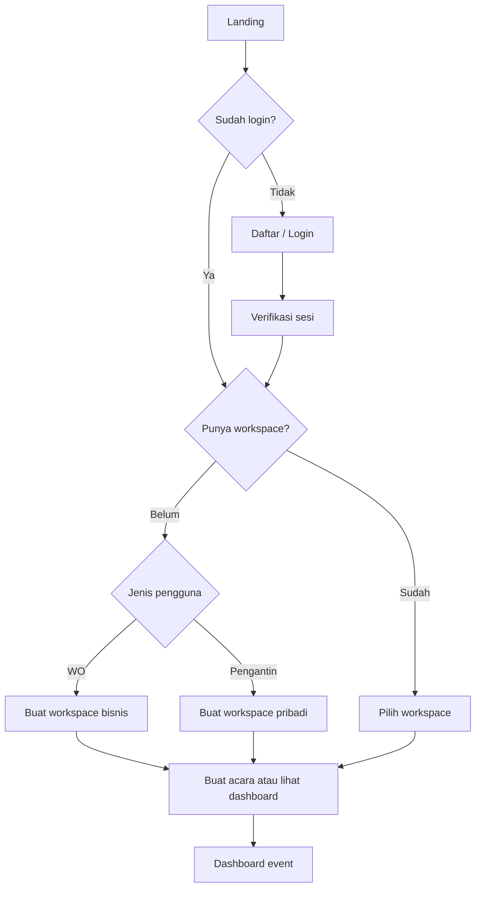
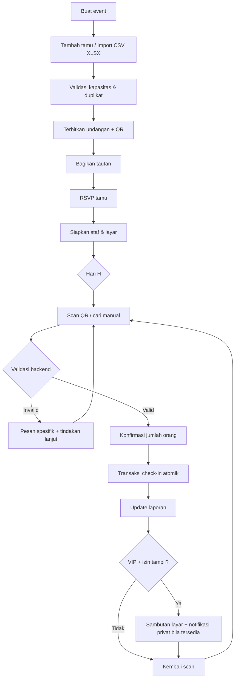
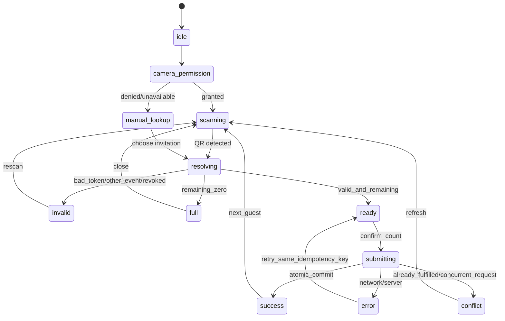

# WEDDINGHUB — UX Flow, Information Architecture & Wireframe Tekstual

**Status:** desain UX siap diturunkan menjadi komponen UI dan route Next.js. **Bahasa:** Indonesia. **Target:** mobile scanner 360–430 px, tablet 768 px, desktop 1280 px; adaptive di ukuran lain.

## 1. Peta navigasi (information architecture)

```text
PUBLIC
├─ /                           Landing + paket
├─ /auth/login                 Masuk
├─ /auth/register              Daftar
├─ /auth/forgot-password       Lupa password
└─ /i/[publicToken]            Undangan tamu + RSVP + QR (khusus token)

AUTHENTICATED
├─ /onboarding                 Pilih peran utama -> workspace
├─ /app/workspaces             Pilih workspace jika >1
├─ /app/w/[workspaceId]        Dashboard WO/workspace
│  ├─ /events                  Semua acara
│  ├─ /team                    Anggota organisasi
│  └─ /settings                Profil WO + branding dasar
└─ /app/e/[eventId]            Dashboard acara (shared engine)
   ├─ /guests                  Daftar invitation group
   │  └─ /import               Import Excel wizard
   ├─ /invitations             Desain, preview, publikasi
   ├─ /rsvps                   Balasan RSVP
   ├─ /checkin                 Mobile-first scanner & manual
   ├─ /vip                     Kedatangan VIP/usher
   ├─ /display                 Kelola pairing TV
   ├─ /reports                 Laporan & ekspor
   ├─ /team                    Keanggotaan event
   ├─ /plan                    Paket (payer)
   └─ /settings                Pengaturan acara

DISPLAY
└─ /display/[sessionId]        Fullscreen restricted display

PLATFORM ADMIN
└─ /admin                      Activate license + audit terbatas
```

**Menu mengikuti role dan paket.** Jangan render tindakan yang tak boleh dijalankan, tetapi tetap **cek permission di backend** (hide button bukan mekanisme keamanan).

## 2. Diagram alur

### 2.1 Onboarding



### 2.2 Persiapan sampai hari-H



### 2.3 Check-in state machine



## 3. Design system

**Mood:** modern, bersih, premium, nyaman untuk petugas. Jangan gunakan gaya undangan floral yang memenuhi dashboard operasional.

**Tokens**:
```text
color.bg          #FAF8F4
color.surface     #FFFFFF
color.text        #172033
color.primary     #15263F
color.accent      #B28A50
color.success     #16805D
color.warning     #B66F15
color.danger      #C33F49
color.border      #E8E7E2
radius.card       16px
radius.button     10px
space             4, 8, 12, 16, 24, 32px
focus             visible high-contrast outline
```

Gunakan komponen standar `shadcn/ui` dengan Tailwind. Form dengan label di atas input, helper text, error inline. Status visual juga memakai teks/ikon agar tidak bergantung pada warna. Gunakan kerangka desktop sidebar + header, mobile top header + bottom action khusus scan. Tabular figures untuk angka. Semua currency IDR locale `id-ID`.

## 4. Screen-by-screen specification

### S01 — Landing (`/`)
**Audience:** publik. **Prioritas:** P1. **CTA utama:** `Mulai Gratis`; sekunder: `Lihat Paket`, `Masuk`.

```text
+---------------------------------------------------------------+
| WeddingHub   Fitur     Paket                         Masuk      |
|                                                               |
|   Kelola Tamu Pernikahan Tanpa Ribet                           |
|   Undangan -> RSVP -> Scan QR -> Laporan                        |
|   [Mulai Gratis]  [Lihat Cara Kerja]                            |
|                                                               |
|  [Undangan Digital] [QR Check-in] [Layar VIP] [Laporan]         |
|  Free / Pro / Pro Plus | FAQ | Footer privasi & kontak          |
+---------------------------------------------------------------+
```
**States:** harga bukan pembayaran aktual bila integrasi belum tersedia; CTA register. Tampilkan fitur `Segera hadir` jika belum tersedia.

### S02 — Register / Login (`/auth/register`, `/auth/login`)
**Fields:** email, password, confirm password pada register; lupa password, toggle password, persetujuan kebijakan. **CTA:** `Daftar`, `Masuk`.

```text
+-----------------------------+
| [Logo] Selamat Datang       |
| Email                       |
| [nama@contoh.com          ] |
| Password                    |
| [••••••••                 ] |
| [Masuk]                     |
| Belum punya akun? Daftar    |
+-----------------------------+
```
**States:** pending email verification, invalid login, rate-limited, expired session; redirect intended route setelah login jika sah. Jangan pernah menampilkan pesan yang mengonfirmasi keberadaan akun dengan cara tidak aman.

### S03 — Onboarding (`/onboarding`)
**Fields:** pilih jenis workspace `Saya Wedding Organizer` / `Saya Calon Pengantin`; nama bisnis/pasangan; slug unik otomatis editable; lokasi opsional. **CTA:** `Lanjutkan`.

```text
Pilih cara menggunakan WeddingHub
( ) Wedding Organizer     — Kelola banyak acara
( ) Calon Pengantin       — Kelola pernikahan sendiri
[Nama Workspace______________________]
[Buat Workspace]
```
**States:** invalid slug, duplikasi workspace, loading, return existing on repeated submits.

### S04 — Workspace switcher (`/app/workspaces`)
Kartu semua workspace dengan type/badge role. **CTA:** `Buka`, `Buat Workspace Baru`. Peran satu akun bisa ganda. Tidak boleh menampilkan workspace yang tidak memiliki membership aktif.

### S05 — Dashboard WO (`/app/w/[workspaceId]`)
**Top:** pemilih workspace, notifikasi, profil. **Sidebar:** Ringkasan / Acara / Tim WO / Pengaturan. **Cards:** acara aktif, mendatang, selesai, undangan semua acara (agregat berizin). **Table:** 5 event berikutnya; nama pasangan, tanggal, lokasi, status, plan, tombol buka.

```text
+----------------+------------------------------------------------+
| LOGO & WO NAME | Dashboard WO                   + Buat Acara    |
| Ringkasan      | [Aktif: 8] [Mendatang: 2] [Selesai: 10]       |
| Semua Acara    |                                                |
| Tim WO         | ACARA TERDEKAT                                 |
| Pengaturan     | Andi & Putri | 20 Nov | Pro    [Buka]          |
|                | Dimas & Intan| 25 Nov | Free   [Buka]          |
|                |                                                |
+----------------+------------------------------------------------+
```
**Empty:** `Belum ada acara. Buat acara pertama`.

### S06 — Dashboard Pengantin / Event (`/app/e/[eventId]`)
**Header:** foto pasangan, tanggal, venue, status event, menu role. **Summary:** total invitation groups, kapasitas orang, RSVP datang, checked-in persons, checked-in groups, VIP hadir. **CTA:** `Kelola Tamu`, `Lihat Undangan`, `Mulai Check-in` (role check). **Activity:** check-in terbaru tanpa data berlebihan.

```text
Andi & Putri — 20 November 2026 [Draft/Live]
[Undangan 450] [Kuota Orang 800] [RSVP Orang 286]
[Orang Hadir 0] [Grup Hadir 0] [VIP 0]
[Tambah Tamu] [Undangan] [Laporan]
Aktivitas terbaru / Tips langkah berikutnya
```
**States:** draft vs published vs live vs archived; guard editing jika archived; kartu disertai definisi metrik.

### S07 — Buat / Edit Acara (`/app/e/[eventId]/settings`)
**Fields:** nama pasangan A/B, nama event/slug, tanggal, mulai-selesai, timezone, alamat, kota, venue, maps URL opsional (divalidasi), foto cover, catatan internal, privacy settings; owner workspace read-only. **CTA:** `Simpan Draft`, `Publikasikan`.

**Validations:** tanggal benar; end after start; format URL; ukuran file; event tidak dapat dipindahkan ke workspace lain tanpa alur otorisasi khusus.

### S08 — Daftar Tamu (`/app/e/[eventId]/guests`)
**Controls:** search, filter kategori (Reguler/VIP/VVIP), status (belum RSVP/RSVP/sudah hadir), pagination, tombol `Tambah Tamu`, `Import Excel` (plan gate), `Buat QR`. Tabel desktop dan kartu mobile:

```text
Daftar Undangan                                    [+ Tamu] [Import]
[Cari nama________________] [Kategori v] [Status v]
Nama                 Kuota  Hadir  RSVP  Kategori     Aksi
Budi & Keluarga        4      2     4    VVIP       [Detail]
Siti Rahma            1      0     1    Reguler    [Detail]
```
**Tambah/Edit modal:** nama penerima, kapasitas, tipe individu/pasangan/keluarga, phone optional, kategori, meja optional, catatan internal, checkbox `Izinkan nama muncul di layar sambutan` (default **tidak dicentang**). Tidak boleh mengurangi kapasitas di bawah jumlah sudah check-in.

### S09 — Import Excel (`/app/e/[eventId]/guests/import`)
**Wizard 4 langkah:**
1. Download template dan pilih file XLSX/CSV.
2. Mapping kolom, preview 10 baris, menandai kolom wajib.
3. Validasi semua baris, duplikat, kuota paket, pilihan skip/error correction.
4. Konfirmasi dan tampilkan `X sukses`, `Y gagal`; unduh error list (tidak berisi data dari event lain).

**CTA:** `Upload`, `Validasi`, `Import yang valid`, `Kembali`. Jangan langsung memasukkan data sebelum review. Jika partial batch dipilih, tampilkan akibatnya eksplisit.

### S10 — Undangan Digital (`/app/e/[eventId]/invitations`)
**Tabs:** Desain / Preview / Daftar Tautan. **Design form:** template pilihan, nama pasangan, foto, teks sambutan, tanggal, tempat, link maps, RSVP enabled. **CTA:** `Simpan Draft`, `Publikasikan`, `Pratinjau`, `Salin Link` per tamu, `Bagikan via WhatsApp` menggunakan share intent/manual, bukan blast.

```text
Template: [Classic Ivory] [Modern Navy] (premium locked)
Konten:  [Nama Pasangan] [Tanggal] [Lokasi] [Teks Sambutan]
[Pratinjau Mobile]         [Publikasikan]
--------------------------------------
Undangan Tertuju       Link/QR         RSVP
Budi & Keluarga       [Salin] [QR]     Hadir 4
```
**States:** tidak ada tamu, template premium locked, unpublished, token revoked, saat user ubah desain semua URL tetap valid jika tidak diputar.

### S11 — Undangan Publik + RSVP (`/i/[publicToken]`)
**Mobile-first:** cover, nama pasangan, tanggal/lokasi, nama penerima, undangan pribadi, form RSVP, detail QR check-in untuk tamu yang berhak. **Form:** hadir/tidak hadir/belum pasti, jumlah hadir (<= kapasitas), ucapan opsional pendek dengan validasi. **CTA:** `Kirim RSVP`, `Lihat QR`.

**Security:** tidak menampilkan nomor HP atau notes internal. Status expired/revoked jelas tanpa membocorkan daftar tamu. Public token tidak bisa digunakan untuk API admin. Tidak perlu login; rate limiting.

### S12 — Scanner (`/app/e/[eventId]/checkin`)
**Mobile one-hand:** Nama event, indicator online, jumlah hadir, kamera, tombol `Cari Nama Manual`, `Beralih Kamera`, `Matikan Suara`, `Tutup Scanner`.

```text
< Kembali     Andi & Putri       [ONLINE]
Hari H | Hadir 124 orang
+-------------------------------------+
|                                     |
|       [ Area Kamera / QR Frame ]    |
|                                     |
+-------------------------------------+
[Arahkan QR ke dalam kotak]
[Cari Nama Manual]  [Riwayat Saya]
```
**States:** kamera belum diizinkan -> instruksi+fallback; kamera tidak tersedia -> manual search; offline -> hentikan klaim sukses live, SOP; invalid QR -> red result with retry. QR resolve tidak langsung check-in sampai petugas konfirmasi jumlah.

### S13 — Konfirmasi Check-in (`/app/e/[eventId]/checkin`, sheet/modal)

```text
[VALID] Budi & Keluarga          [VIP]
Kapasitas 4 | Hadir 2 | Tersisa 2
Meja: VIP-01
Jumlah tambahan:     [-]  1  [+]
[Konfirmasi 1 Orang Datang]
[Batalkan]
```
**After submit:** success sheet berisi penambahan, total/sisa, CTA `Scan Berikutnya`. Jika status concurrent: `Kuota tamu berubah, silakan scan ulang` (backend authoritative). Gunakan idempotency key sama hanya untuk retry request yang belum diketahui statusnya; scanning berikutnya menghasilkan key baru.

### S14 — Pencarian Manual (`checkin` sub-screen)
Search name dengan debounced request, daftar kandidat terbatas event aktif, tampilkan kapasitas/sisa, butuh petugas memilih group dan mengonfirmasi. Bila nama sama, tampilkan petunjuk pembeda terbatas (kategori/meja atau nama penerima), bukan semua nomor HP. Log `method=manual`.

### S15 — Panel VIP / Usher (`/app/e/[eventId]/vip`)
**Supervisor:** tab `Belum Datang`, `Baru Datang`, `Butuh Penjemputan`, `Selesai`. Kartu nama tamu sesuai role, kategori, meja, waktu scan, usher ditugaskan, status diakui. **Usher:** hanya notifikasi yang ditugaskan, tombol `Saya Tangani`/`Selesai`. MVP dapat menampilkan daftar manual VIP; push/ack realtime Pro Plus tahap berikutnya.

### S16 — Pengaturan Display (`/app/e/[eventId]/display`)
**Left:** preview ukuran 16:9; **Right:** enabled/disabled, pairing code sementara, durasi sambutan 5–15 detik, mode private, autoplay, nama pasangan/background. **CTA:** `Hubungkan Layar`, `Cabut Akses`, `Pratinjau`. Pairing code tidak menjadi URL permanen. Display yang dicabut langsung kehilangan akses.

### S17 — Fullscreen Display (`/display/[sessionId]`)

```text
+------------------------------------------------------------------+
|                                                                  |
|                         THE WEDDING OF                           |
|                         ANDI & PUTRI                             |
|                                                                  |
|                     Selamat Datang                               |
|                       [Nama Tamu]                                |
|                (hanya jika explicitly allowed)                   |
|                                                                  |
|                  [Arah Meja bila berizin]                         |
+------------------------------------------------------------------+
```
Saat queue kosong kembali layar default. Tampilkan badge koneksi kecil untuk operator hanya pada debug/config mode, bukan detail sensitif ke publik. Jika expired, tampilkan mode generik dan instruksi untuk operator.

### S18 — Laporan (`/app/e/[eventId]/reports`)
**Summary:** jumlah undangan, kapasitas, RSVP total, hadir orang, hadir invitation groups, no-show, kategori VIP. **Filter:** kategori, tanggal/jam, petugas, cara check-in. **Table:** waktu, nama penerima, jumlah tambahan, petugas, metode; koreksi tercatat. **CTA:** `Export CSV`, `Export XLSX` (plan). Metrik dihitung di server DB.

### S19 — Tim Acara (`/app/e/[eventId]/team`)
Table anggota: nama/email, role, status undangan, last active. **CTA:** `Undang Anggota`, `Ubah Role` (jika diizinkan), `Cabut Akses`. Dialog `Email`, `Role`, `Kirim/Salin Link`. Tidak boleh mengundang role lebih tinggi dari sendiri; prevent last-owner removal.

### S20 — Paket & Upgrade (`/app/e/[eventId]/plan`)
3 kartu paket; fitur/limit aktual dari server. **CTA:** `Pilih Pro`, `Pilih Pro Plus`, `Hubungi Admin / Ajukan Upgrade` pada manual activation. Status transaksi: `Menunggu Verifikasi`, `Aktif`, `Ditolak`, `Kedaluwarsa`. Jangan membuat tombol Bayar yang berpura-pura menerima uang. Owner pembayaran melihat invoice/request, staff tidak.

### S21 — Admin Platform (`/admin`)
Admin terbatas: ringkasan workspace/event/plan; daftar permintaan upgrade; verifikasi manual -> aktivasi paket -> catatan audit; fitur support tanpa membaca private guest list secara default. Login dan role auth wajib.

## 5. Struktur navigasi per role

| Role | Menu default pertama | Menu lainnya |
|---|---|---|
| Owner WO | Dashboard WO | Acara, Tim WO, Pengaturan, Paket event |
| Couple | Ringkasan Event | Tamu, Undangan, RSVP, Laporan |
| Event Manager | Ringkasan Event | Tamu, Undangan, Check-in, Display, Laporan, Tim |
| Supervisor | Ringkasan hari-H | Check-in, VIP, Laporan shift |
| Receptionist | Scanner | Cari manual, Riwayat saya |
| Usher | VIP masuk | Perlu dijemput, Selesai |
| Viewer | Ringkasan | Laporan yang diizinkan |
| Platform Admin | Panel admin | Upgrade requests, Plans, Audit |

## 6. States, dialog, dan microcopy Bahasa Indonesia

| Kondisi | Microcopy | Tindakan |
|---|---|---|
| Belum ada tamu | `Belum ada undangan. Tambahkan satu tamu atau import Excel.` | Tambah/Import |
| QR invalid | `QR tidak dikenali untuk acara ini.` | Pindai lagi / Cari manual |
| Kuota habis | `Semua 4 tempat untuk undangan ini sudah tercatat hadir.` | Tutup / minta supervisor |
| Konflik scan | `Jumlah kehadiran baru saja berubah. Periksa kembali sebelum melanjutkan.` | Muat ulang data |
| Offline | `Koneksi terputus. Check-in online belum dapat dilakukan.` | Coba lagi / lihat SOP |
| Kamera ditolak | `Akses kamera belum diberikan.` | Ubah izin / cari manual |
| Paket penuh | `Batas 50 undangan Free tercapai.` | Upgrade / kembali |
| VIP private | `Tamu tercatat hadir. Sambutan publik tidak ditampilkan.` | Scan berikutnya |
| Tidak berizin | `Anda tidak memiliki akses untuk tindakan ini.` | Kembali |
| Empty RSVP | `Belum ada konfirmasi dari tamu.` | Lihat undangan |
| Display expired | `Sambungan layar berakhir. Hubungkan kembali melalui dashboard.` | Pair ulang |

Gunakan toast untuk sukses non-kritis, dialog eksplisit untuk tindakan destruktif (cabut akses, rotasi token). Submit button loading dan disabled untuk menghindari accidental double click; validasi backend tetap wajib.

## 7. Rute dan data per komponen

- `AppShell`: current user, active workspace, membership and entitlements from server.
- `DashboardCards`: aggregated metrics, no guessed hardcoded numbers.
- `GuestTable`: event-scoped paginated server list; filter & search URL state.
- `GuestForm`: schema fields from database; capacity bounds and plan limits.
- `ScannerView`: camera frames client-side; sends decoded QR token, never full auth secret.
- `ScanResultSheet`: `capacity`, `checked_in_count`, `remaining` from authoritative server.
- `DisplayFullScreen`: restricted display session; only approved payload.
- `ReportCharts`: aggregate numbers from ledger, explicit labels for group vs people.
- `FeatureGate`: subscription computed server-side; client only mirrors UX.

## 8. Responsive details

- 360px: scanner full width, bottom fixed CTA, horizontal overflow avoid; form one column; tables turn to cards.
- 768px: two-column event overview, tablet check-in comfortable, modal as drawer/sheet.
- 1280px: sidebar 240px, cards 3–4 columns, table with pagination and fixed actions.
- Loading skeleton for dashboard, search debounce, stop camera stream on unmount, show camera permission guidance, handle browser camera limitations and HTTPS requirement in deployment.
- Screen orientation: TV fullscreen landscape 16:9 with CSS responsive fallback to 4:3.

## 9. Developer UX completion checklist

- Semua 21 screen punya initial/loading/empty/error/success state atau alasan eksplisit bila tidak relevan.
- Semua tombol nyata terhubung ke endpoint/handler nyata atau disabled dengan label `Segera hadir`, tidak ada tombol palsu.
- Role-specific navigation konsisten; unauthorized direct URL ditolak server.
- Semuanya nyaman dalam Bahasa Indonesia, termasuk error.
- Responsive scan diuji dengan kamera nyata; fallback manual bekerja.
- Screenshot tiap role dan peran pada breakpoint mobile & desktop untuk review.
